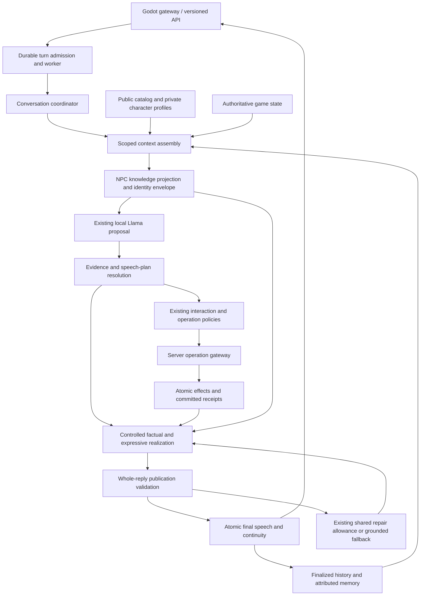

# Dialogue grounding: high-level design

Date: 2026-10-20 (Asia/Kolkata). Status: proposed architecture for review. This document authorizes no production changes, model changes, deployments, save migration, or release-gate closure. It contains no implementation task breakdown.

## Purpose and evidence

Provide reliable, characterful conversation for the Craftsman and Gatherer within the game's authored world. Factual answers, character identity, attributed recall, and gameplay authority are separate responsibilities. A fact being present in a prompt is neither evidence that generated prose uses it correctly nor permission to publish that prose.

The behavioral contract is the [proposal](proposal.md), including confirmed decisions D1–D3: both villagers know the player's full current inventory; relevant ordinary disclosures are remembered automatically; unspecified biography receives a brief in-character boundary. The [grounding audit](../evidence/dialogue-grounding-audit-2026-10-20/README.md), [live transcripts](../evidence/dialogue-grounding-audit-2026-10-20/results.md), and deterministic containment/history evidence establish the starting failures. Its 20 live scenarios and 22 accepted turns are diagnostic evidence, not quality rates or latency acceptance.

This design follows the current working-tree production graph, including existing uncommitted work. In particular, the versioned worker path already has durable ordering, attempt accounting, operations, receipts, repair, and atomic finalization. The audit demonstrated a publication gap alongside those protections: seven of eight deliberately unsupported injected replies survived unchanged. It also demonstrated missing public context, reversed history admission order, disappearing profile constraints, missing ordinary memory production, and false-positive keyword guards. No personal database needs to be opened to establish these architectural findings.

## Architecture overview

Retain the durable conversation coordinator. Introduce a consistent knowledge boundary and a controlled realization boundary within that graph. The local Llama proposes what to address, which available facts to use, and how the character responds. Server policies resolve evidence, select permitted speech acts, render bounded factual content, and decide whether the complete reply may be published. Neither generated text nor model-selected evidence IDs acquire authority.

The diagram separates responsibilities, not new services or deployments. Evidence resolution, knowledge policy, realization, and validation should remain local deterministic components within the existing backend. The receipt path may use the already-existing composition inference stage. Ordinary dialogue reuses its proposal and does not gain another composition call.

The central invariant is **complete publication coverage**: every published clause is either a server-resolved factual/attributed clause or an expression accepted by the bounded realization language. There is no unchecked expressive tail. Unsupported or unrecognized text cannot be published merely because it has no references, the model calls it an opinion, or a correct receipt appears next to it.

## Major components and ownership boundaries

| Component / owner | Responsibility | Boundary |
| --- | --- | --- |
| Content authors: village catalog and character profiles | Public identity, roster, work, usual places; personal identity, beliefs, voice, explicit unknowns and prohibitions | Lore is not a capability, inventory, schedule, observation, or executable permission. One NPC's private material is not another's context. |
| Context read adapters and knowledge policy | Read detached scoped evidence; decide what this NPC may know; retain provenance and revisions | A complete execution snapshot and a speaker-visible projection are distinct products. Server-private data never supports public speech. |
| Context assembler | Reserve mandatory knowledge and current input; select recent turns and older recollections within bounds | Admission priority does not determine transcript order. Optional ranking cannot introduce evidence. |
| Local generation adapter | Propose concerns, evidence selections, expressive choices, and disclosure/correction candidates within the existing attempts | Every selection and candidate is untrusted. No permission to invent facts, provenance, memory truth, consent, or receipts. |
| Evidence resolver and realization policy | Resolve factual answer intents against eligible evidence; preserve subject, owner, modality, time, and action status; render character-aware speech | Model prose is not a factual projection. These are new conceptual responsibilities extending current composition seams. |
| Interaction / operation policies and game gateway | Interpret supported requests, clarify ambiguity, bind current-question consent, recheck state, commit at most one mutation | Sole gameplay authority. Speech plans cannot execute operations or create promises of unavailable services. |
| Whole-reply validator | Check complete realization coverage, constraints, support, attribution, dependencies, bounds and receipt consistency | Structural validity or a model-supplied source ID does not establish entailment. Validation cannot grant gameplay authorization. |
| Memory policy and continuity planning | Produce attributed accepted disclosures, correction lineage and scoped recall | Player reports remain unverified reports. Rejected drafts and generated embellishments are not memory sources. |
| Turn store, finalizer and lifecycle | Fenced ordering, attempts, durable receipts, atomic speech/continuity, idempotent delivery, clear/reset | Effects commit separately before final speech; failure to speak never undoes a committed effect. |
| API and Godot presentation | Deliver the durable accepted reply, revisions and complete readable beats | No client synthesis, truncation, speculative speech, or local reinterpretation of outcomes. |

## Knowledge flow and epistemic policy

### One authored public view

Project the small [village catalog](../../backend/app/services/context/village.json) as mandatory shared knowledge for both supported NPCs: Willowbrook, the known Craftsman/Gatherer identities and work, workshop/forest clearing as usual places, and the named known places. Preserve the catalog's qualifications. A list of known residents does not establish an exhaustive census; an empty route catalog does not establish that no physical paths exist. It establishes that no supported route can be supplied.

Both speakers use the same catalog revision and meanings. Their wording may differ. A usual place is rendered as usual, never a live sighting. A location name supplies neither directions nor an escort service. Public work descriptions describe work; sharing wood additionally requires current stock and game rules. Stable occupation does not imply tools, training, consent, or a new service.

### Truth and knowledge are separate axes

For each speech-relevant item retain its subject/owner, source authority, knowledge basis, modality, scope, temporal status, and revision. These are conceptual requirements, not a prescribed wire schema. They distinguish:

| Evidence class | Permitted use in speech |
| --- | --- |
| Public authored knowledge | Shared world identity and qualified public facts. |
| This NPC's authored personal knowledge | This speaker's biography, tastes and beliefs, preserving authored uncertainty and limits. |
| NPC-visible observations and verified events | Only the observed/reported scope and time; no inference of unseen outcomes. |
| Player disclosure or recalled report | “You told me…” or equivalent attribution; never proof of mechanics or firsthand observation. |
| Compatible accepted narrative continuity | Narrative continuity only, subordinate to authored constraints and mechanical authority. |
| Authoritative mechanical snapshot | Available fully to execution. Available to speech only through explicit knowledge policy. |
| Committed operation receipt | Exact committed event and status, with verified direction and quantities; no extrapolated progress. |
| Server-private state | Execution-only; absent from generation and public evidence resolution. |

D1 is an explicit knowledge grant: both villagers always know the full current player inventory. Read it fresh with ownership and revision labels. It does not grant knowledge of unrelated private quest conditions, hidden encounter branches, other NPC inventories, or past transfers. NPC inventory is separately owned; the Craftsman's tools cannot fill a player-inventory answer. A current inventory snapshot cannot prove who transferred an item earlier.

Apply this policy once before any provider serialization, and reuse it for proposal, ordinary speech, receipt reactions, repair and fallback. Greeting and gratitude paths may omit irrelevant details but may not remove identity or alter knowledge permissions. Receipt composition gains only the verified event needed for its reaction; it does not gain access to hidden global state. Execution still receives full authoritative state through its owning ports.

### Persistent identity envelope

Keep speaker identity, stable occupation, concise voice direction, continuity constraints, explicit biography gaps and prohibitions mandatory in every generation stage. Optional topic cards add detail; they cannot remove those invariants. The full source bibles remain authoring assets, not compulsory prompt payloads.

Profile facts also enter evidence resolution and realization constraints. Preserving them in prompts helps generation but does not enforce correctness. The server cannot realize “my father died last winter” when survival is unspecified, even if the model supplies that sentence confidently. D3 yields a brief boundary without invented grief, estrangement, forgetfulness, or an explanation about authoring. The Gatherer's older relative stays an older relative; recall cannot add a teacher's rank or present whereabouts.

Authored constraints govern personal identity; current game state and receipts govern mechanics. Accepted narrative is retained where compatible. Contradictions are handled by domain, rather than a universal rule that would let private server truth become NPC knowledge or let a player report override identity.

## Dialogue, validation and personality flow

### Resolve a response before realizing it

Use the existing ordinary proposal attempt to identify the message's concerns and propose response acts: acknowledge a feeling, answer a public fact, describe personal lore, recall a report, correct a premise, express uncertainty, clarify a request, or discuss a supported action. Equivalent occupation questions and mixed concerns belong to the same response semantics; exact social keywords must not decide whether stable identity exists or force a work question into an action request.

Routing is a convenience for choosing a bounded contract, not an authorization or grounding decision. An uncertain classification defaults to conversation/clarification, with no operation. A mixed request retains its emotional and practical concerns. If intent resolution fails, the system must not claim relevance merely because its eventual answer is safe.

The server resolves proposed factual acts against the current eligible evidence. It owns the answer values and support dependencies. A selected known ID cannot support different wording with a different meaning. An omitted ID is not permission for an ungrounded assertion. Unknown topics receive an uncertainty/boundary act, not invented supporting lore.

### Controlled realization, including the expressive channel

Select **bounded, evidence-driven realization** for the game's factual domains. Factual clauses are rendered from resolved values using meaning-preserving forms, including owner-aware pronouns, quantities, usual/current distinctions, attributed belief/report forms, and offered/accepted/completed states. This extends the existing `FactSlot` / `ReceiptSlot` approach; the current `fact.exact` renderer can emit raw fact content and is not by itself an adequate player-facing answer renderer.

Personality remains a first-class part of realization. The existing model chooses tone, pacing, emphasis, ordering, and expressive response acts, with character-specific phrasing alternatives. The realization language admits bounded expressions of warmth, opinion, emotion, humor, uncertainty and metaphor. It supports combinations of concerns rather than one canned answer per question. Authored personal lore supplies expressive material without adding game facts. Repetition selection can use accepted recent replies without rewriting their history.

For a verifiable boundary, publishable expressive language must be covered by deterministic authored constructions or a bounded recognizer whose accepted forms have defined meanings. Arbitrary generated strings are not trusted inputs to a classifier that claims to detect every hidden assertion. Free prose may be proposed, but only a completely recognized, permitted realization can be retained; otherwise it uses the existing repair allowance or a supported character-aware rendering. This restriction applies to every path, including receipt reactions and fallback.

Examples of accepted meanings include “I don't know where the shop is” as location uncertainty and “The way I see it, mistakes are how we learn” as a figurative opinion. Neither should fail because it contains “shop” or “way.” “Perhaps the shop is behind the inn” still embeds an unsupported location proposition and has no supported realization. An unrecognized paraphrase must not silently pass as nonfactual; broader paraphrase coverage is a quality requirement for the realization language.

This is a deliberate expressive-range tradeoff, not a claim to verify unrestricted natural language. The current unconstrained `ExpressiveSegment` passthrough cannot remain a publication escape hatch. A prompt saying “only be expressive,” a model's own nonfactual label, or a list of regex exceptions would recreate the audit's gap. If controlled realization cannot meet the existing voice, relevance and low-fallback thresholds, the design has not met product acceptance; safety alone is insufficient.

### Final publication validation

Validation operates on the complete assembled reply and its server-owned realization coverage, including connecting words and clauses surrounding factual slots. It checks:

- Every realized clause is covered; factual meanings resolve to allowed evidence with the correct owner, speaker, addressee, direction, modality and time.
- Authored identity and biography bounds hold across all clauses. Uncertainty does not introduce unsupported entities or explanations.
- Offers refer to supported, currently appropriate capabilities. Availability does not mean consent, acceptance or completion. A promise cannot be added by expressive wording.
- Completed outcomes resolve to committed receipts or applicable verified events; an inspection receipt never becomes a repair receipt. Duplicate or conflicting outcome clauses are blocked.
- Source scope, visibility, revisions, memory/correction heads, policy versions, final spans, output bounds and readable beats remain valid.

The resolver and renderer establish support by construction; the final validator checks that the resulting text still has complete coverage and unchanged meaning. Existing narrow contradiction guards can remain defense in depth, but keyword matching and sentence substring equality are not the primary grounding mechanism. Generated canon additions remain fail-closed; this design does not wire a general trusted semantic extractor or expand generated canon production.

On a blocking finding, use the existing shared single repair allowance when eligible and within deadline. Repair receives the same mandatory identity and knowledge view plus targeted findings; it cannot broaden knowledge, create a request or replace an operation decision. A receipt-bearing failure uses receipt-preserving grounded rendering, consistent with current production recovery. Exhausted or unavailable generation uses a relevant supported answer/boundary where resolvable, preserving character voice and the committed outcome. A universal generic fallback is not the normal factual-answer path.

### Uncertainty, false premises and corrections

Unknown weather, unauthored founding history, live whereabouts without observation, and unspecified relatives remain unknown. Known facts should still be answered: a false Willowdale premise receives Willowbrook without an invented etymology. Missing evidence for “you gave me three axes” yields no confirmation and no inferred reverse transfer. The distinction between “no evidence of it” and “it never happened” matters, especially for legacy or incomplete event records.

Prior accepted speech proves that something was said. If an earlier NPC line conflicts with authored identity or mechanical evidence, preserve the chronological transcript and acknowledge/correct the relevant statement naturally. Do not rewrite the old turn or adopt its error as canon. A correction cannot expose a secret merely because the server knows it; it must use permitted knowledge or state an appropriate limitation.

## History and context flow

The SQL reader already selects eligible finalized prior turns in the same scope/NPC/epoch and returns them chronologically. Retain that contract. Budget admission considers the newest complete turns first, then **sorts retained turns into finalized sequence order before exposing the packet**. Compact speech, profile follow-up selection, and other consumers all use that chronological contract.

With prior sequences 1–5 and sufficient budget, the packet is `[1,2,3,4,5]`; its most recent four are `[2,3,4,5]`. Under pressure, prefer newer eligible whole exchanges, retaining their chronology. A larger skipped optional exchange must not make an older topic look newer. Short follow-ups resolve against the latest applicable player topic and correction. Accepted fallback exchanges are eligible history; rejected drafts, repair inputs and failed attempts are not.

Reserve the current message, identity/bounds, public knowledge, applicable fresh mechanical evidence and required interaction constraints before optional material. Older narrative, selected details and memories cannot crowd them out. Preserve whole attributed records; do not truncate a correction, uncertainty label or factual sentence to fit. If the mandatory envelope exceeds policy, skip inference and use the existing safe bounded degradation route rather than silently dropping constraints.

Budget the actual provider envelopes for proposal, composition and repair, including output reservation. The current lexical counter is an estimate, not an exact Llama tokenizer; retain conservative headroom and observe actual usage without claiming exact token fit. Compact representation must preserve the same meanings, not select a different truth policy.

## Attributed memory flow

### Production from ordinary accepted exchanges

Create a disclosure-candidate path for relevant preferences, personal circumstances, explicit corrections and retractions during ordinary conversation, without a remember command. Reuse the current proposal call for candidate selection; do not add a memory-extraction inference call. A bounded deterministic disclosure recognizer can cover clear direct disclosures even when the provider fails or a fallback is accepted. Questions, quoted speech, hypotheticals, negated assertions and ambiguous references are not normalized into asserted personal facts.

The memory source is the exact player statement in a finalized exchange. Model paraphrases and proposed relations are untrusted: validate exact spans against the accepted input, preserve the subject and modality, and retain the original excerpt as the durable report payload when normalization is not deterministically justified. Source-span equality proves what was said, not the truth of what was said or the correctness of a guessed subject. Ambiguous candidates remain unattributed/unresolved conversational material outside asserted personal recall, or trigger clarification; they must not become a definite preference.

Replace the accidental coupling in which a report must be cited by final NPC prose to become eligible memory. Instead, continuity planning explicitly accepts eligible disclosures from the current exchange and binds their player-message provenance to that exchange's final publication. An NPC need not repeat a disclosure for it to be remembered. The accepted reply and memory plan commit atomically, after validation. A valid disclosure may survive a provider failure when a safe reply is finalized; a rejected NPC draft cannot contribute memory. If no exchange finalizes, no memory is committed.

Each recollection retains the receiving NPC, game scope, epoch, attributed subject, exact source turn/message, uncertainty, active status and correction lineage. A player's report that a transfer occurred remains a player report and cannot substantiate a receipt. Quoted NPC history cannot become a new player's personal fact or acquire firsthand status. Memory production and recall quality are measured separately from mere transcript retention.

### Correction and recall

Resolve explicit correction/retraction against relevant current memory heads. Retire or supersede the old assertion and persist the lineage with the accepted exchange. A clear “I prefer quiet now, not jokes” must not leave both preferences active as equally current. If the target is ambiguous, suppress conflicting definite recall and ask a concise clarification; do not guess the link or revive the disputed value because it scores higher in retrieval.

The SQL memory store is authoritative. Retrieve active eligible records with current heads and lineage before relevance ranking. Candidate selection must allow an older relevant disclosure to be found after many unrelated turns; lexical ordering of memory IDs and a fixed recent candidate slice are not adequate recall semantics. A bounded scoped topic/text selection with source-sequence recency is the baseline, with no embeddings required. Limits remain explicit; a candidate miss is uncertainty, never a license to invent recall.

Optional summaries are selections of attributed entries, not free narrative rewriting. The existing summary service/store can support recoverable refresh outside mandatory turn processing, with current lineage checks; it is not a substitute for producing missing reports. Recall renders “you told me…” with preserved uncertainty and current correction status. It never silently assigns a player taste to the NPC or another NPC's private history to this speaker.

Clear changes the conversation epoch and removes conversational payloads/pending requests while preserving accepted mechanics, receipts and compatible generated canon under existing semantics. A new game changes scope and resets run-specific state/canon. Retrieval, summaries, caches and pending refresh all obey those boundaries. Durable source resolution must work beyond the visible transcript window and after restart, without copying the entire old transcript into prompts.

## Gameplay action and receipt flow

Keep [interaction policy](../../backend/app/services/conversation/interactions.py), [operation policy](../../backend/app/services/conversation/operations.py), and the [game adapter](../../backend/app/services/conversation/adapters/game.py) as the existing authority chain. A proposed action must match a supported player request; ambiguity clarifies. Current-question consent remains bound to exact terms. There is no timer/turn negotiation expiry introduced here.

The gateway rechecks authoritative state under the existing lock order and commits effects plus receipt atomically. At most one mutation occurs per turn. Cross-NPC work remains concurrent where permitted, with shared resource revisions preventing stale actions or speech. No provider, embedding, ranking, or semantic callback runs inside a database transaction or under game locks.

Once committed, the receipt is immutable evidence. Composition may add a permitted reaction and must include the exact supported outcome. An accepted inspection, a completed inspection and completed ship repair remain different states. A service offer has no effect by itself; a supported capability is not a promise that its preconditions will hold later.

Final speech and continuity have a separate atomic commit. Relevant evidence changes require bounded refresh/reassembly outside locks and renewed validation, using remaining attempts and deadline. The current production finalizer has no refresh hook wired; this design calls for deterministic re-resolution/fallback through that existing seam, not fresh inference or another execution. An immutable receipt remains valid as a past event while stale current-state clauses are refreshed or omitted. Lost ownership or uncertain commits use durable lookup/recovery; they are not regeneration triggers. Speech failure never reverses effects or causes replay of a committed operation.

## Existing components to reuse

| Existing component | Reuse and architectural gap |
| --- | --- |
| [Production assembly](../../backend/app/services/conversation/application.py), [coordinator](../../backend/app/services/conversation/coordinator.py), [worker](../../backend/app/services/conversation/worker.py), turn store | Keep the durable graph, attempt accounting, fencing, ordering and restart recovery. Add grounding responsibilities inside its ports. |
| [Context adapter](../../backend/app/services/conversation/adapters/context_read.py), [scoped reads](../../backend/app/services/conversation/adapters/scoped_reads.py), [assembler](../../backend/app/services/conversation/context.py) | Reuse detached source checks and budgeting; expand public projection, make epistemic policy consistent, restore chronological output, and improve eligible memory candidate selection. |
| [Profiles](../../backend/app/services/context/character_profiles.py), [prompt builder](../../backend/app/services/prompts/builder.py), [speaker projection](../../backend/app/services/prompts/knowledge.py) | Reuse authored voice/cards and knowledge seam; make stable work/bounds mandatory on all paths. Prompt changes alone are not containment. |
| [Structured adapter](../../backend/app/services/llm/structured.py), [speech wire](../../backend/app/services/llm/speech_contract.py) | Reuse local provider, typed decoding, deadlines and bounds. The current prose-only `SpeechDraft` loses reports/dependencies and cannot express the proposed response plan; an internal versioned contract evolution is needed, not a claim that the current wire already supports it. |
| [Composition and assembly](../../backend/app/services/conversation/composition.py), [validator](../../backend/app/services/conversation/validation.py) | Reuse fact/receipt rendering and exact spans; extend to controlled semantic realization and full coverage. Current expressive passthrough and optional offline canon projections do not establish factual support. |
| [Memory policy](../../backend/app/services/conversation/memory.py), [summary store](../../backend/app/services/conversation/adapters/summary_store.py), persistence contracts | Reuse attributed revisions, correction links and source resolution; connect ordinary disclosure acceptance to finalization. Summary production is not currently wired into ordinary production. |
| [Repair](../../backend/app/services/conversation/repair.py), [fallback](../../backend/app/services/conversation/fallback.py), [finalizer](../../backend/app/services/conversation/finalization.py), [lifecycle](../../backend/app/services/conversation/lifecycle.py) | Preserve one shared repair, receipt-safe recovery, atomic continuity and clear/reset. Apply the same knowledge/realization policy to degraded output. |
| [Chat routes](../../backend/app/api/routes/chat.py), [Godot gateway](../../frontend/godot/scripts/conversation_gateway.gd), [presenter](../../frontend/godot/scripts/conversation_presenter.gd) | Keep versioned submission/status, revision-aware delivery and complete readable beats. The legacy route is a separate compatibility surface, not proof that this design covers every chat path. |

## External dependencies and inference decisions

The mandatory runtime remains the existing Python backend, FastAPI/Pydantic contracts, SQLAlchemy and the supported SQLite/PostgreSQL persistence environments, the configured local Ollama/OpenAI-compatible endpoint with `llama3:willowbrook`, and the Godot client. Authored files remain local content dependencies. No hosted inference, web knowledge, new service, or new model is selected. The audit's model digest and configuration identify its baseline; they do not prove future quality for a changed contract.

| Approach | Benefit | Cost / limitation | Decision |
| --- | --- | --- | --- |
| More prompt instructions, richer context and unrestricted expressive prose | Small architectural change; broad verbal variety | Already fails despite supplied facts; citations and regex guards miss unsupported meanings and reject harmless language | Necessary context repairs, insufficient publication design. |
| Controlled evidence resolution and realization within existing attempts | Deterministic bounded-domain support, attribution, receipts and uncertainty; no extra inference latency | Authoring/recognition coverage and repetition risks; reduced unrestricted phrasing; internal contract evolution | Selected, conditional on existing quality acceptance. |
| Online semantic judge / separate claim extractor / another model | Could expand paraphrase and free-prose coverage | Additional inference latency, compute/memory, calibration and correlated-error risks; judges can miss unsupported claims; larger failure surface and changed budgets | Not selected. No hidden judge behind a “semantic validation” interface. |

A future judge would need evidence that controlled realization cannot meet required expressive coverage, measured improvements in containment and false positives, and comparison with better authored forms, deterministic normalization, and improved use of the existing call. Its incremental call count, local resource load, ordinary/action/repair p50/p95 latency, timeout behavior and acceptance impact would need explicit evaluation. Even then it could not authorize gameplay or create receipts, and would not provide a perfect truth guarantee. This document adds none of those calls.

The [semantic retrieval adapter](../../backend/app/services/conversation/adapters/semantic_retrieval.py) and FAISS/embedding components exist in the working tree behind configuration; they are disabled in the audited configuration, and the master record does not establish their production acceptance. They are optional ranking technology, not necessary public-knowledge delivery or factual validation. Enabling them entails local embedding inference, cold-start/resource costs and retrieval latency even without a new chat-model call. This design keeps a deterministic retrieval baseline; any later enablement needs measured recall benefit over lexical/topic selection and an explicit latency evaluation. Index failure must degrade to scoped SQL candidates, never introduce evidence or block receipt recovery.

## Reliability, latency, privacy and observability

**Reliability.** Preserve queue, lease, fence, request idempotency and per-NPC finalized sequence rules. Persist attempt reservations before dispatch; a lost response does not justify repeating inference or an effect. Publication checks exact source/correction heads and active scope/epoch. Stale knowledge causes re-resolution or bounded failure, not silent acceptance. Mandatory-source failure yields a safe limitation or service error; optional retrieval/summary failure yields reduced recall. Unsupported or unrecognized clauses are blocked uniformly, including adjacent to a valid outcome.

**Latency.** Keep one ordinary proposal attempt, the existing action composition opportunity, the shared single repair allowance, and existing total/stage/output/context bounds. Resolve and render locally; do not introduce an intent-model, memory-model, judge, or additional regeneration loop. Extra mandatory knowledge and a richer response plan still cost tokens and local-model time; eliminating extra calls does not make them free. Reserve the complete stage envelopes, omit whole optional detail, and use deterministic degradation when required content cannot fit. Measure queue wait, context/read, generation, action, composition, repair, validation and publication separately. Do not invent new numeric budgets: product latency/readability acceptance remains open under T03.

**Privacy.** Keep player disclosures and embeddings, if ever enabled, local. D2 permits bounded relevant retention, not indefinite recording of every utterance as memory. Scope all reads/writes/caches by game, NPC and epoch; preserve clear/new-game semantics and prune/reject obsolete index/summary content. D1 is a narrow intentional inventory-visibility exception. Sensitive conversation content must not appear in routine operational logs; use IDs, versions, counts, categories and timings. Detailed prompt/transcript captures belong only in controlled diagnostic evidence with the existing retention policy. Public speech never exposes evidence IDs, validators, private reasoning or source bookkeeping.

**Observability.** Trace a turn across admission, context, proposal, resolution, operation, realization, validation, repair/fallback and final publication. Record model/config/contract versions; public/profile revisions; retained history sequences; eligible/selected memory counts and correction heads; knowledge-denial and unsupported/unknown-realization categories; raw candidate versus accepted output; attempt counts; receipt presence/status; and stage latency. Distinguish a model fabrication, a resolver rejection, a validation miss, a harmless-language rejection, a relevant supported fallback and an irrelevant fallback. A generated origin is not correctness; a blocked mutation is not truthful dialogue.

For evaluation, retain new isolated evidence with exact outgoing context, final speech, accepted source lineage and before/after game state. Measure disclosure eligibility/production, recall after eviction/restart, correction suppression and isolation independently. Track coverage omissions and repeated phrasing as well as containment. Aggregate ordinary/action/repair p50/p95 and denominators by NPC and scenario class; do not mix injected containment cases into naturally occurring hallucination rates.

## Risks and mitigations

| Risk | Mitigation and remaining limit |
| --- | --- |
| Controlled realization becomes generic or repetitive | Character-specific expressive constructions, authored personal detail and model-selected ordering/tone; preserve emotion plus practical answers. Existing voice/relevance/fallback thresholds remain decisive. Broader vocabulary needs explicit supported coverage. |
| A recognizer quietly becomes a claimed general semantic verifier | Make its accepted language bounded and inspectable; unknown coverage blocks publication. Never treat model labels, silence from regex guards, or source IDs as complete coverage. |
| Correct facts answer the wrong concern or miss mixed questions | Preserve separate concerns and measure final meaning/relevance on equivalent and mixed prompts. Server support resolution is not proof of intent understanding. |
| Missing or inconsistent authored content | One versioned public projection and explicit personal bounds; gaps yield natural uncertainty. Do not expand canon to make an invented response true. |
| Old hallucinated replies or memories contaminate continuity | Retain historical speech as speech; validate current heads and attribution, subordinate mechanics to state/receipts, and correct conflicting statements. Do not silently promote legacy text to facts. |
| Report extraction stores quotation, hypothesis, wrong owner or stale correction | Exact player spans, conservative direct-disclosure eligibility, preserved modality, accepted-exchange provenance, explicit correction lineage and clarification for ambiguity. Measure missed eligible disclosures as failures too. |
| Bounded candidate retrieval misses older relevant memory | Query-aware scoped candidate selection, source-sequence recency and current heads; summary selection may help. Missing recall remains a stated limitation; ranking cannot repair absent memory production. |
| Concurrent state/content changes make an answer stale | Exact dependencies and version checks at publication; deterministic refresh outside locks with remaining budget. Past immutable outcomes and current state use different temporal semantics. |
| Contract evolution breaks recovery or rollback | Version turn-local policy/contracts and persist durable outputs. Recover accepted results/receipts under compatible readers; unknown formats fail safely. Never regenerate an operation to reconstruct speech. |
| Additional context/recognition work harms playability | Bounded local work and actual-envelope accounting; measure end-to-end latency and repair frequency on final configuration. No extra inference is assumed affordable. |
| One API path bypasses grounding | Treat legacy compatibility explicitly during rollout; do not advertise system-wide guarantees while a reachable publishing path remains outside the boundary. |

## Migration and acceptance strategy

Migration is an additive, versioned change within the current worker architecture, not a new conversation engine. First establish observational parity for knowledge projection, chronology, constraints, disclosure eligibility and realization coverage against isolated captured scenarios. Shadow decisions cannot publish speech, produce memories or trigger operations. They reveal both unsupported candidates and false-positive rejections before a policy becomes authoritative.

Adoption then uses a coherent turn-local policy version: context projection, response contract, resolver/renderer, validation and memory acceptance must agree. It must not combine a new claimed grounding guarantee with the old unchecked expressive fallback. Old finalized results remain idempotently deliverable. Pending old turns require compatible recovery or conservative receipt-aware completion; no mid-turn contract reinterpretation and no additional attempt allowance. Internal contract/storage compatibility requires explicit review before any future implementation; this document mandates no reset or backfill.

Existing history is not rewritten, and legacy transcripts are not automatically imported into durable reports. Future accepted disclosures gain the new provenance path. Existing valid scoped memory remains usable if its source, subject and lineage can be established. Unverifiable rows cannot become trusted recollection through migration. Authored identity, compatible accepted canon, personal saves and committed receipts are preserved. Any future evaluation uses fresh disposable worlds and new evidence paths, never either existing `mvp.db` save or overwritten audit captures.

Rollout should retain a safe pause/recovery mode and a compatible reader for finalized results and receipts. Rolling back generation must not fall back to unsafe prose publication, undo effects, replay requests or discard accepted disclosure/correction lineage. Presentation remains on the existing versioned API; legacy clients must be held outside the new guarantee until they share the same publication boundary or are deliberately paused. No new public API shape is selected here.

Acceptance follows proposal A1–A12: deterministic injected containment and harmless-language controls; shared public facts; identity across ordinary/action/repair paths; chronological retention; disclosure → eviction → restart → attributed recall; correction/retraction and isolation; ownership/direction; and receipt-safe recovery. No pass is claimed by this design. Live quality must demonstrate useful factual answers and distinct personality, not only successful rejection.

Preserve the frozen suite of at least 40 scenarios, generally 4–8 turns, and its denominators; identify added grounding regressions separately if the frozen denominator is unchanged. Existing requirements remain relevance ≥90%, mixed-concern coverage ≥90%, canon consistency ≥95%, healthy-provider fallback <5%, and accidental identical consecutive replies <2% excluding purposeful mechanical repetition. Report factual failures and ordinary/action/repair latency, plus existing product latency/readability acceptance. Preserve applicable mechanical, isolated SQLite/PostgreSQL, API, Godot lifecycle/retry, recovery and rollback gates and the existing human-review waiver.

The [master progress record](../redesign-master-progress.md) distinguishes historical engineering integration from open T03 quality/product-latency acceptance and dependent T04 broader rollout. Neither the audit nor this architecture closes those gates. The remaining architectural acceptance question is whether bounded realization plus the current local Llama can meet the required expressive range, disclosure coverage and playability together; that must be demonstrated on the final configuration before expanding its publication guarantee.
