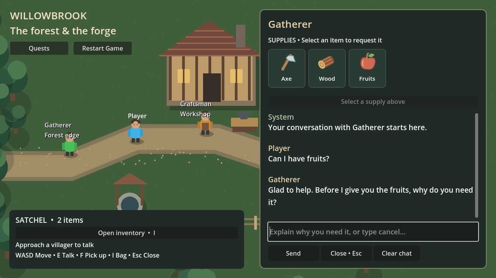
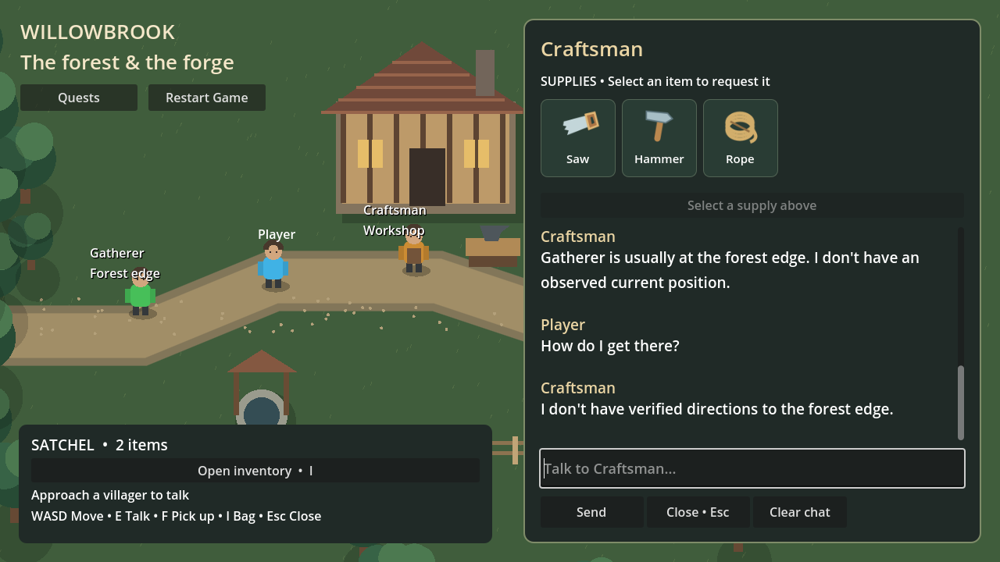
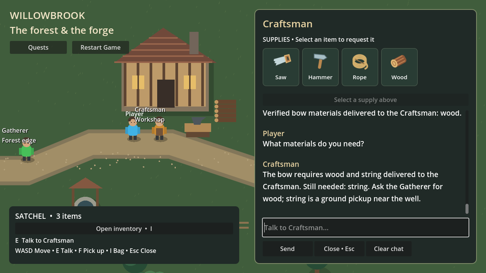
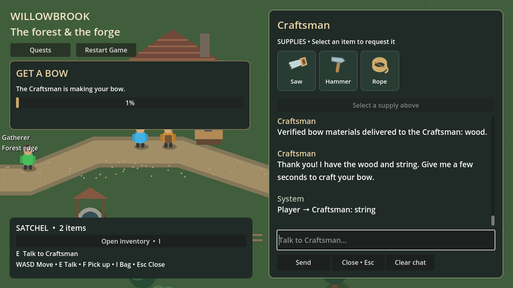
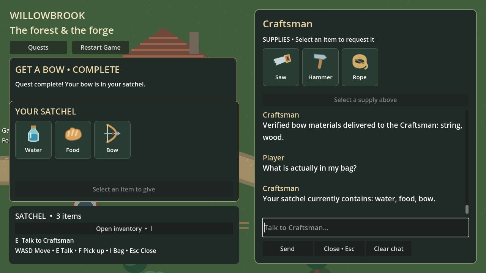
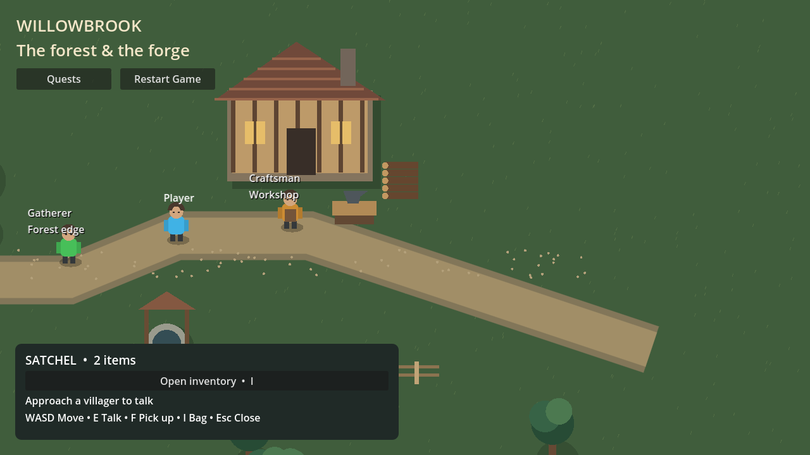

# Recorded rendered Godot walkthrough

Captured automatically on 2026-10-13 (Asia/Kolkata) from real Godot 4.5.1 rendering and production HTTP routes against a disposable world. These are recorded screenshots, not a live session, manual playthrough or continuous video. Generation used configured `llama3:latest` at temperature 0.2 with schema enabled; embeddings used `nomic-embed-text`. Helpful/distrustful initial NPC states are controlled fixtures, not effects of remembered experience.

The live run passed **334/334 checks**, including scene relaunch, full backend/Godot restart, one timed bow reward, repeated reward polling and disposable reset. All **9/9 memory source links** and **42/42 captured chat decision-trace links** are valid. The separate rendered provider-failure run passed **22/22 checks**, with two rejected zero-effect replies and no important memories.

[Live summary](summary.json) · [Godot checks and displayed responses](godot.json) · [Restart/reset checks](resume.json) · [Shareable decision traces](decision-traces.json) · [Provider-failure summary](../godot-decision-provider-failure-v1/summary.json)

Original conversation/full-response captures are local audit artifacts, separate from the bounded shareable decision-trace export. All nine PNGs were visually inspected at 1280×720. The final presentation/recording format and release-quality threshold remain unagreed; D3 and authored mandatory recovery remain deferred.

## Optional refusal

The distrustful Craftsman visibly refuses an optional rope request. Required quest steps remain protected without authored recovery.

## Helpful cooperation

The helpful Gatherer asks for purpose before transferring owned fruits; the runner then returns that fixture item through the authoritative service.

## Location and missing directions

Both NPCs give the permitted usual-location fact and explicitly state that verified directions are unavailable.

## Partial material delivery

Wood is verified as delivered; string remains outstanding. The subsequent scene relaunch preserves position, phase, transfers and grounded dialogue.

## Timed crafting

Delivering the second material starts the existing crafting timer. The bow is not awarded instantly.

## One completed reward

The satchel shows one bow. Delivery evidence survives consumption of the materials. Full backend and Godot process restart subsequently preserves completion, position, history and the unique reward; repeated polling creates no duplicate.

## Disposable reset

The runner confirms reset only in its temporary world. Quest phase, satchel, position and old dialogue return to initial state.

## Actual generation provider failure

A separate temporary run points generation at an unreachable local endpoint. The real Godot dialogue shows fallback, controls recover, and parsed decision traces explicitly report provider/decode failure with no authorized action or important memory write. This is connection failure, not a simulated slow timeout or an embedding outage.

