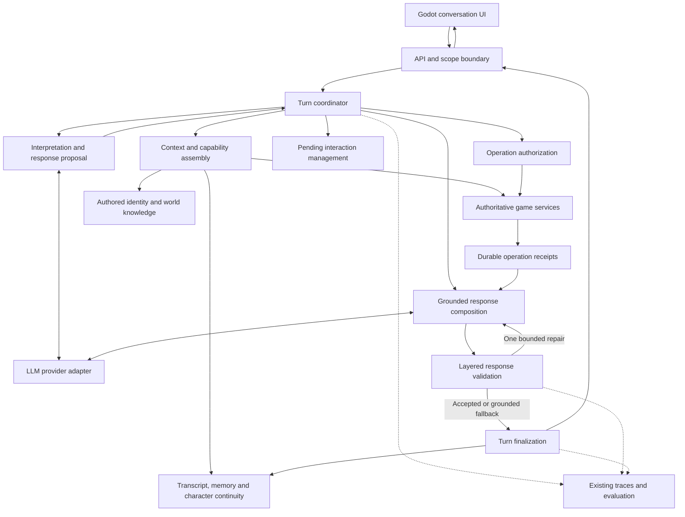

# NPC Conversation Redesign — High-Level Design

Date: 2026-10-14

Status: Proposed high-level design incorporating confirmed product decisions

Source: [NPC Conversation Redesign Proposal](npc-conversation-redesign-proposal.md)

## 1. Purpose and scope

Provide NPC conversations that answer the player's actual concerns, preserve context across topics, develop recognizable characters, and accurately represent what the game can do and has done.

The first design optimizes for **one world, one active save, one clear current player, and a clean game-scope reset path**. It extends the existing Godot client and Python backend. Component boundaries below describe responsibilities within that backend, not separate deployed services.

The design covers conversation orchestration, context, interpretation, grounded responses, operation authorization, character continuity, memory, client presentation, and evaluation. It does not define implementation tasks, schemas, endpoint signatures, or a delivery schedule. Multiplayer, separate player profiles, autonomous world creation, generated executable recipes or quests, and automatic propagation of invented history between NPCs are outside scope.

## 2. Confirmed product decisions

- Generated biography, relatives, preferences, anecdotes, and personality development are allowed. Accepted generated details become narrative-only canon within the current game.
- Authored NPC identity, canonical world lore, permanent authorial profiles, and deliberately declared static facts remain authoritative. Changing them requires an explicitly authorized story/content event.
- A player challenge is a claim, not an edit to biography. The NPC may accept, correct, deflect, or dispute it. An accepted narrative correction must be explicit, consistent with authored constraints, and recorded as a revision rather than silently replacing history.
- Clear chat preserves generated canon, gameplay relationship and encounter progress, and accepted actions. It clears the selected NPC's transcript, conversational memories, emotional interpretations, and pending negotiations.
- New game clears generated canon and all old run-scoped state, including transcript, memories, emotional and relationship state, pending requests, and encounter-specific dialogue state. It preserves authored identity, lore, profiles, and declared static facts.

These decisions refine the proposal where it describes recommended defaults. Numerical latency budgets remain deliberately subject to baseline measurement, as specified by the proposal; this design does not invent a shipping threshold.

## 3. Architecture overview

The backend owns the conversation lifecycle and all mechanical authority. The model interprets language and proposes speech and operations. Existing deterministic game services authorize and execute supported operations. The client displays validated dialogue and applies authoritative state results.

The primary separation is between **what an NPC can say about its life** and **what can authorize a game change**. Narrative storage, summaries, player reports, and model output never become alternative sources of inventory, quest, capability, or execution truth.

## 4. Major components and relationships

| Component | Responsibility and output | Principal relationships |
| --- | --- | --- |
| API and scope boundary | Accept bounded player input for the current player and NPC; associate it with the active game scope and turn identity; return a compatible result | Connects Godot to the coordinator and rejects obsolete scope requests |
| Turn coordinator | Own turn ordering, deadlines, recovery, operation limits, repair budget, and finalization | Coordinates all conversation components without duplicating their rules |
| Context and capability assembly | Produce a bounded context containing relevant evidence, visible history, canon, unresolved subjects, and currently supported operations | Reads continuity, authored knowledge, pending interactions, and game-service views |
| Interpretation and proposal | Identify multiple concerns, references, reports, corrections, request modality, candidate operations, and proposed narrative additions | Uses the shared prompt contract and provider adapter; returns proposals to the coordinator |
| Pending interaction management | Track the question awaiting an answer and whether a negotiation is active, suspended, cancelled, fulfilled, or expired | Uses interpretation to relate a message to a negotiation; authorization rechecks consent and preconditions |
| Operation authorization and execution boundary | Enforce scope, ownership, permission, intent, targets, preconditions, and operation identity | Delegates execution to existing state, inventory, encounter, navigation, and quest services |
| Receipt and turn persistence | Preserve accepted operation results and enough lifecycle state to recover interrupted turns | Couples operation effects with durable receipts; supplies composition and retry recovery |
| Grounded response composition | Combine expressive language with approved factual segments and receipt-based outcome wording | Uses current evidence and the provider; renders critical values and outcomes under server control |
| Layered validation and fallback | Check structural validity, grounding, continuity, relevance, and style; return specific findings and relevant degraded speech | Gates finalization; permits one targeted repair without re-executing operations |
| Continuity and memory | Maintain final transcript, summaries, player reports, narrative canon, verified experiences, and correction relationships | Supplies scoped context; accepts only finalized dialogue and appropriately sourced memories |
| Godot presentation | Display readable final replies in order and distinguish speech from actual actions | Consumes backend state and turn/scope identity; never interprets model output as a game command |
| Diagnostics and evaluation | Explain response origin, measure reliability and conversation quality, and support reproducible comparisons | Extends existing tracing and replay facilities; has no gameplay authority |

The shared prompt contract applies to every NPC. Authored traits, established canon, current attitude, activity, and role-specific capabilities are data supplied to it. A Craftsman-specific personality or fallback must not become the default for the Gatherer.

## 5. Information ownership and trust

| Information class | Owner/source | Permitted use |
| --- | --- | --- |
| Current mechanical state | Authoritative game services | Explain the present situation and evaluate operations through game rules |
| Verified event or operation receipt | Committed game execution | Explain what happened; affect gameplay only where an explicit rule consumes it |
| Authored identity and world knowledge | Game content | Constrain character identity and world claims, filtered by what the NPC knows |
| Generated character canon | Finalized NPC speech | Preserve narrative continuity; never create capabilities or world entities |
| Player report or challenge | Player statement | Discuss an attributed claim; never treat assertion alone as verified state |
| Conversation interpretation | Contextual inference | Track apparent emotion, topic, or unresolved concerns with uncertainty |

Current state takes precedence over stale mechanical memories. Authored constraints take precedence over conflicting generated biography. Explicit accepted revisions supersede older narrative details while preserving their provenance. Merely repeating a claim does not increase its authority.

Global validation access is broader than an NPC's knowledge. The system may inspect a private fact to reject an operation without exposing that fact to the model or player. Context retrieval must respect both game scope and NPC knowledge boundaries.

Generated canon is separate from verified event memory. Invented relatives and distant places remain narrative references, not playable catalog entries. For example, a childhood story about carpentry may establish background; it cannot unlock a recipe, create a shop, or promise an unsupported repair.

## 6. Data flow and control flow

### 6.1 Ordinary conversation

1. The API associates the message with the current player, NPC, active game scope, and stable submitted-turn identity.
2. The coordinator establishes the turn's position in the conversation and reads a scoped snapshot without retaining database locks during generation.
3. Context assembly combines the current message, recent visible exchanges, relevant canon and memory, current capabilities, and unresolved interactions. It reserves space for current constraints before older anecdotes.
4. One ordinary generation call produces a compact interpretation and candidate reply. A single message may contain emotion, factual questions, and a practical request.
5. Composition integrates approved factual segments. Validation checks the entire assembled reply, including contradictions between expressive framing and grounded segments.
6. A specific repairable defect may trigger one targeted regeneration within the total deadline. A remaining defect or provider failure selects a relevant fallback.
7. Finalization persists the final reply, its source/status, accepted continuity changes, and turn outcome consistently. Only then is the final result eligible for display.

The accepted transcript contains the player's message and the exact final NPC response, including fallback responses. Rejected drafts remain diagnostic material and never enter accepted memory. Canon is admitted only from final validated speech that actually introduces the detail. Final results are recoverable for delivery retries; generation alone is not publication.

### 6.2 Action-bearing conversation

The interpretation identifies whether a proposed operation is direct, quoted, hypothetical, negated, or ambiguous. Neither a confidence score nor a fluent promise is authorization. Ambiguous intent leads to a specific clarification.

For a clear supported request, authorization reacquires current state and checks scope, revisions, ownership, role, capability, and consent context. Execution allows at most one mutating operation per turn. Existing services commit the effect and its receipt atomically, then release the transaction.

Composition uses the receipt to distinguish an accepted commitment, activity in progress, and completed outcome. A scheduled inspection supports “I'll come with you,” but not “I've inspected it.” Action turns may require a second generation call for this final wording. If speech generation fails after execution, a receipt-based fallback reports the actual result; retrying speech never repeats the operation.

Before publication, changed scope or activity state is considered again. A historic receipt remains valid evidence of an earlier result, but must not be presented as proof that an activity is still ongoing after cancellation.

### 6.3 Pending interactions and topic changes

Only one item-transfer negotiation is active initially. It records its originating turn, target, exact outstanding question, applicable preconditions, and status. A topic change suspends the negotiation without implying approval or cancellation. An explicit return to the subject can resume it after revalidation.

A bare “yes” applies only to a compatible current question. A purpose statement must refer to the pending request; incidental words such as “for” or “because” are insufficient. Cancelled, expired, or invalidated negotiations cannot authorize an operation. Expiration and changed availability must be surfaced clearly, without silently substituting another item.

### 6.4 Memory and summaries

Recent exchanges remain verbatim across social, factual, and action topics. Older conversation can be summarized periodically or under context pressure, outside the mandatory per-turn generation path. Summaries preserve attribution, uncertainty, corrections, and source references.

Retrieval prioritizes relevance, recency, unresolved commitments, and current correction status. Emotional interpretations are temporary observations, not permanent diagnoses. Accepted canon remains meaningful character detail rather than a record of every passing sentence.

## 7. Save, clear-chat, and reset lifecycle

The active save owns a game-scope identity. The server resolves the one current player from that save; requests cannot select an arbitrary alternative player. NPC identity alone is insufficient to identify a run because authored NPCs survive new games.

| State | Clear chat for an NPC | New game |
| --- | --- | --- |
| Authored identity, profiles, lore, declared static facts | Preserve | Preserve |
| Accepted generated canon | Preserve | Clear from the active game |
| Transcript, conversational summaries and memories | Clear for that NPC | Clear old run |
| Conversational emotional interpretations | Clear for that NPC | Clear old run |
| Pending negotiations | Clear for that NPC | Clear old run |
| Gameplay relationship and encounter progress | Preserve | Reset |
| Accepted actions, inventory and quest state | Preserve | Initialize the new run according to game rules |
| Authoritative event evidence and operation receipts | Preserve as needed for gameplay and recovery | Invalidate old-scope access; never replay into the new run |

Clearing a chat is not undoing gameplay. Conversation memories can disappear while authoritative evidence of a transfer or accepted commitment remains. Canon records retain sufficient origin metadata to remain valid after their source transcript is cleared, without retaining the cleared transcript as hidden conversation context.

A clear-chat boundary invalidates in-flight conversational publication for that NPC, even though the game scope remains the same. Old drafts must not repopulate cleared history or introduce new canon. Previously committed operations remain authoritative and recoverable.

A new-game boundary invalidates the old game scope across requests, generation, retrieval, summaries, caches, and client display. Reset and operation commits have a defined ordering: an operation either belongs to the old run before reset or is rejected as stale. Old responses cannot write into or animate the new run. Scope isolation is required even if old diagnostic records are retained temporarily.

The UI explains both reset behaviors. It must not imply that clearing chat erases an NPC's established biography or reverses an accepted action.

## 8. External dependencies and integration boundaries

These dependencies follow the existing repository and proposal; no new hosted service is required by this design.

| Dependency | Architectural role | Failure or change boundary |
| --- | --- | --- |
| Godot client | Input, dialogue presentation, animations, authoritative state display | Delayed delivery must not duplicate state changes; stale replies are suppressed |
| FastAPI, Pydantic and SQLAlchemy | Existing API, contract validation and persistence infrastructure | New internal conversation contracts remain compatible with existing client fields |
| Configured relational database, currently SQLite or PostgreSQL | Active save, mechanical state, turn recovery, receipts and continuity | Required for durable correctness; supported configurations must preserve transaction and ordering guarantees |
| OpenAI-compatible generation provider, including local Ollama configurations | Interpretation, expressive dialogue, optional repair/composition | Untrusted output, bounded deadlines, explicit provider failure and degraded status |
| Existing semantic-memory dependencies: local embeddings and FAISS cache | Relevant-memory retrieval | Database records remain authoritative; embedding/index failure should permit scoped nonsemantic retrieval |
| Existing game content and deterministic services | Identity, world knowledge, permissions, encounters, navigation, inventory and quests | Their rules remain the sole authority for mechanics |

The current `llama3:latest` configuration is a baseline, not a model-selection decision. Provider/model versions and generation settings must be recorded for meaningful comparison. Mock mode is explicit testing support and must not masquerade as a healthy live provider.

Preserve `final_dialogue` and existing world-state response fields while introducing a versioned internal conversation result. The frontend receives validated results, not raw model proposals. The separate dialogue-composition module must not become a second, conflicting policy owner; the live conversation path and any reused composer need a consistent contract.

## 9. Key design decisions and tradeoffs

| Decision | Rationale | Tradeoff |
| --- | --- | --- |
| Keep cohesive backend components within the current deployment | Fits one world/save/player and existing services | Requires clear internal ownership despite shared runtime and storage |
| Unified context and multi-concern interpretation | Preserves follow-ups and mixed emotional/practical requests | More careful context budgeting than binary social/world routing |
| Separate narrative canon from mechanics | Allows personality development without invented gameplay | Adds provenance, revision, and continuity responsibilities |
| Hybrid expressive speech and exact mechanical rendering | Retains natural voice with reliable critical facts and outcomes | Composition can sound stitched; whole-response quality checks remain necessary |
| One ordinary generation call; extra calls only when justified | Controls play latency and provider cost | Action receipts and repair can make some turns slower |
| At most one mutation and one targeted repair per turn | Limits transactional and failure complexity | Compound requests may require later turns; failed repair falls back |
| Durable receipts and explicit turn ordering | Makes retries, crashes, and concurrent submissions recoverable | Requires persisted lifecycle state beyond chat text |
| Scoped turn ordering with short commit transactions | Keeps displayed dialogue aligned with accepted context and canon | May queue overlapping messages; correctness takes precedence over parallel speech generation |
| Semantic checking offline first, selectively at runtime | Avoids an always-on classifier/planner/critic chain | Runtime prose checks remain imperfect and require calibrated evaluation |
| Versioned behavior with additive persistence changes | Allows controlled adoption and rollback | Old and new contracts need temporary compatibility |

An always-on multi-agent conversation chain would add latency and more failure boundaries without addressing the missing context and authority separation identified in the proposal. A fixed response bank remains useful for degraded operation but cannot provide the desired conversational breadth.

## 10. Security, reliability, and observability

### Security and trust boundaries

Player text, retrieved narrative, and provider output are untrusted data. Prompt instructions do not grant permissions. Structured operations are checked against supported commands, bounded parameters, valid targets, and current game rules; free-form text never invokes arbitrary functions or executes code.

All reads and writes are bound to the active save, game scope, and relevant NPC. Character knowledge is filtered before prompt assembly. Provider credentials remain server-side and absent from logs. Transcript and draft access and retention are limited; only context needed for the turn is sent to the configured provider.

The initial deployment follows the local game's trust boundary. Game-scope IDs provide lifecycle isolation, not user authentication. Exposing the backend to untrusted remote users would require a separate authenticated access design and is not implied by this single-player architecture.

### Reliability

- Never hold database locks while waiting for generation, repair, or summarization.
- Persist operation effects and receipts atomically. Recover a submitted turn by its existing identity rather than creating another mutation.
- Persist the final reply and accepted continuity changes consistently so invisible rejected drafts cannot establish biography.
- Recheck evidence at mutation and publication boundaries; summaries and asynchronous results must respect scope and clear-chat invalidation.
- Distinguish provider failure, validation failure, persistence failure, and unavailable gameplay. Do not report a durable success when persistence is uncertain.
- Use a total turn deadline, at most one repair, and a relevant fallback. Failure to generate speech cannot erase a committed operation.
- Treat memory indexes as disposable caches. Retrieval degradation must preserve scope and attribution, even if recall quality declines.
- Rollback may disable new generation/composition and leave canon inactive, but must preserve executed actions and receipts. Shadow evaluation cannot mutate game state or active canon.

### Observability and evaluation

Extend existing traces with turn/NPC/scope identity, relevant state revisions, provider/model configuration, prompt and schema versions, response route, relevant context IDs, operation authorization and receipt, validation findings, repair outcome, and final response origin. Record stage timing, token usage where available, and repetition/fallback rates. Store concise decisions and evidence spans rather than hidden model reasoning.

Keep accepted conversation separate from debug drafts. Developer diagnostics expose provider health and degraded behavior; NPC speech stays in-world. Logs must explain whether a poor result came from retrieval, interpretation, authorization, generation, validation, or fallback.

Mechanical correctness and conversation quality are separate acceptance dimensions. Unauthorized or duplicate actions, unsupported outcome claims, narrative-to-mechanics promotion, and reset/retry violations are release blockers. Conversation evaluation covers directness, mixed-concern coverage, continuity, character consistency, grounding, and naturalness across both Craftsman and Gatherer.

Retain the proposal's evaluation basis of at least 40 multi-turn scenarios, human-calibrated review, and reproducible model/state fixtures. Its proposed targets remain targets rather than measured results: at least 90% relevance and mixed-concern coverage, at least 95% canon consistency, healthy-provider fallback below 5%, and accidental consecutive repetition below 2%. Report latency p50/p95 separately for ordinary, action, and repair routes; establish the shipping budget from measured play requirements. Zero observed mechanical failures is a release condition, not a proof of universal safety.

## 11. Risks and mitigations

| Risk | Impact | Mitigation |
| --- | --- | --- |
| Generated story implies a reachable shop, usable item, or capability | Player pursues a nonexistent affordance | Validate practical implications against authored/current evidence; keep unsupported references historical or nonlocal |
| Quoted, hypothetical, negated, or unrelated language is mistaken for consent | Unwanted action | Explicit modality and pending-question checks plus deterministic authorization; clarify ambiguity |
| Model or semantic checker misses a contradiction | Misleading speech or character inconsistency | Server-controlled critical clauses, whole-response checks, accepted-canon references, and human-calibrated regression review |
| Generation times out after a successful action | Duplicate operation or false failure message | Durable receipt recovery, stable submitted-turn identity, and exact receipt-based fallback |
| Reset or clear chat races with generation or summary work | Old history or speech reappears | Game-scope and conversation invalidation boundaries checked before publication and persistence |
| Concurrent turns use stale context or create conflicting biography | Disordered dialogue and inconsistent canon | Defined conversational ordering, revision-aware finalization, and state revalidation |
| Summaries turn reports into facts or revive corrections | False memories influence later replies | Source-linked attribution, explicit supersession, scoped retrieval, and current-state precedence |
| Provider and context demands exceed playable latency | Conversation interrupts play | One-call ordinary path, bounded context and repair, route-specific timing, evidence-based model choice |
| Fallback hides a broken generation path | Safe but repetitive dialogue appears healthy | Record final-response origin and provider health; evaluate quality separately from schema validity |
| Clearing chat accidentally breaks action recovery | Accepted actions repeat or lose evidence | Separate conversational deletion from authoritative receipts and gameplay state |
| Compatibility paths enforce different length or grounding rules | Valid responses are truncated or rejected | Shared versioned contract across provider output, validation, API, composer, and readable UI beats |

## 12. Design boundaries

This document establishes component responsibilities, information authority, lifecycle behavior, and failure handling. It intentionally leaves concrete schemas, interfaces, numerical tuning, test implementation, and task sequencing to subsequent design or planning work. No implementation plan or task breakdown is included.

Supporting repository context: [Architecture Mapping](architecture.md), [project README](../README.md), and the source proposal. Existing behavior is evidence for integration boundaries, not a claim that the proposed redesign has been implemented.
