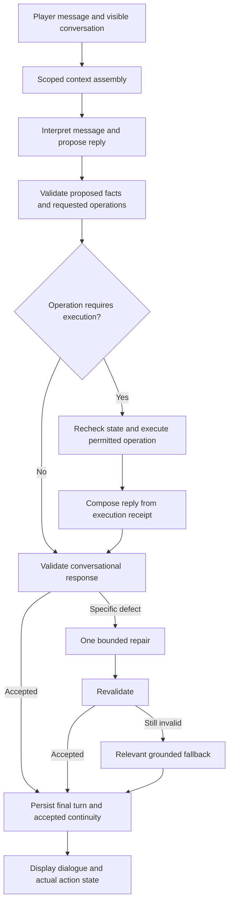

# NPC Conversation Redesign Proposal

Date: 2026-10-14  
Status: Proposed architecture for discussion; implementation has not started  
Scope: Backend NPC conversation, grounding, action interpretation, character continuity, memory, evaluation, and the frontend behavior needed to support them

## 1. Intended outcome and agreed creative boundary

NPCs should understand what the player says, answer the actual question, carry a conversation across turns, and express a recognizable personality. They should be able to respond to emotion and practical requests together, remember corrections, change topics, disagree, and admit uncertainty.

The user explicitly permits NPCs to invent their own backstory and personality. This proposal therefore allows generated personal history, relatives, tastes, anecdotes, opinions, emotional expression, and character development. Those details should become consistent parts of the character once accepted and spoken.

Real behavior, items, capabilities, permissions, and action outcomes must remain grounded in the game. A story about learning carpentry from a parent does not unlock a crafting recipe. A remembered voyage does not create a traversable route. Saying “I gave you a hammer” requires an executed transfer. Saying “I will follow you” requires an accepted following command; saying “I repaired it” requires verified completion.

The design must support both creative freedom and mechanical reliability. It must also distinguish them internally: generated biography is narrative continuity, not evidence of executable game state.

### Success from the player's perspective

- The NPC answers the substance of the message, including mixed emotional and practical content.
- Follow-ups make sense without requiring the player to repeat context.
- Characters maintain their identity and previously established personal details.
- The NPC describes its actual capabilities and current situation accurately.
- Rejections, unavailable actions, and uncertainty lead to relevant responses.
- Repetition serves a conversational purpose rather than exposing a tiny response menu.
- Response time remains suitable for play.

## 2. Evidence and limits of the diagnosis

This proposal builds on [the recovery document](npc-dialogue-quality-recovery.md) and inspection of the current working tree. That tree includes ongoing Craftsman and Gatherer changes. Historical evidence files do not necessarily describe this exact revision.

Local probes exercised the existing classifier, validator, history filter, and item-request resolver without running live generation or executing game transfers. They confirmed these cases:

| Input or situation | Current behavior | Consequence |
| --- | --- | --- |
| “Are you happy here?” with “There is comfort in familiar work.” | Rejected as a world question requiring constrained output | A valid personal answer cannot reach the player |
| “Do you enjoy working here?” with “I have a soft spot for careful work.” | Rejected as an inventory/quest claim | Harmless idiom triggers fallback |
| “Do you ever feel scared?” with “Fear can destroy your confidence.” | Rejected as a friendly threat | Keyword matching mistakes reflection for threatening behavior |
| A wreck report followed by a social turn | The social history filter removes the report and its response | The NPC loses context needed for an emotional follow-up |
| A wood request is pending; player asks about the NPC's work | Resolver repeats the question about the wood's purpose | Pending gameplay monopolizes conversation |
| A wood request is pending; player says “I like to sit quietly” | Resolver proposes a wood transfer | A broad purpose-word heuristic can misinterpret an unrelated sentence |

Other confirmed code paths:

- Social prompts omit the normal fact catalog.
- Factual answers replace all generated wording with server-rendered fact text.
- Some action requests bypass generation and return fixed dialogue.
- Rejected exchanges are excluded from recent prompt history, including the player's input and the final fallback they saw.
- `_validate_or_repair` does not perform a generation repair; it returns fallback dialogue.
- The Craftsman fallback contains three response branches.
- The prompt provides a Craftsman profile but no equivalent Gatherer profile.
- The local configuration selects an OpenAI-compatible provider with `llama3:latest`; this does not identify the provider or failure path of every gameplay session.

We have not yet established the live proportions of provider errors, validation failures, successful but repetitive scripted responses, and irrelevant generated responses. Baseline measurement is an implementation prerequisite, not a reason to delay the architectural proposal.

## 3. What changes from the original recovery plan

The recovery document correctly identifies routing, validation, fallback, and memory problems. This proposal changes the emphasis:

1. Replace the social-versus-world permission gate with a unified conversation contract.
2. Preserve relevant context across social, factual, and action turns.
3. Separate narrative continuity from mechanical authority.
4. Interpret multiple conversational needs instead of assigning a single response category.
5. Let grounded facts and permitted actions participate in natural dialogue.
6. Repair specific response defects before discarding the whole response.
7. Keep authored response banks as degraded-mode support and exact mechanical rendering, not the main conversational engine.
8. Evaluate actual conversations, not only schema validity and state safety.

More regex categories would remain brittle, and more fallback variants could conceal a broken generation path. Neither should be the centerpiece.

## 4. Architecture overview

Most ordinary conversation should use one generation call. Turns that execute an operation may need a second call so the final wording reflects the real result. Do not build an always-on chain of separate classifier, planner, writer, critic, and summarizer calls.

Existing deterministic world services remain the authority. New components should be small enough to inspect independently: context assembly, turn interpretation, action authorization, response composition, validation, and continuity persistence.

## 5. Introduce explicit information classes

Every context entry and stored memory needs a clear meaning and source. The following classes are conceptual; implementation should reuse compatible existing provenance types rather than overload them with new meanings.

| Class | Examples | May support dialogue? | May authorize gameplay? |
| --- | --- | --- | --- |
| Current mechanical state | Owned items, quest phase, current activity | Yes | Only through the appropriate game service |
| Verified event | Successful transfer, completed inspection | Yes | Only where game rules explicitly consume that event |
| Authored world knowledge | Public villagers, supported places, recipes | Yes, within the NPC's knowledge | Only through explicit game rules |
| Generated character canon | Childhood, relatives, tastes, formative stories | Yes | Never |
| Player report | Claimed wreck, fear, claimed delivery | Yes, as a report | Never on its own |
| Conversation interpretation | Apparent worry, unresolved question, topic | Yes, with uncertainty | Never |

Current authoritative state overrides stale memories for mechanical questions. Authored world constraints override incompatible generated biography. Later explicit corrections may supersede earlier narrative details, but ordinary generation must not silently rewrite established canon.

A provenance label does not prove that a statement is relevant to the question. Relevance needs separate evaluation.

## 6. Replace binary routing with whole-message interpretation

Remove `is_social_message()` as the mechanism that determines which context or response form the NPC is allowed to use. Retain narrow deterministic recognizers only for well-defined shortcuts or checks where their behavior is appropriate.

The model should produce a compact structured interpretation alongside its proposed reply:

- Questions and concerns to address, possibly more than one.
- Referenced people, objects, and prior conversation topics.
- Player reports, preferences, and corrections.
- Candidate requested operation, if any.
- Whether that operation is direct, quoted, hypothetical, negated, or ambiguous.
- Which pending interaction, if any, the message addresses.
- Candidate character details introduced by the reply.

This is not a request for hidden reasoning or a lengthy chain of thought. Store concise decisions and evidence spans needed for debugging.

Do not use a model's confidence number as permission to execute. Operation acceptance still requires a supported command, valid target, current preconditions, and sufficiently clear player intent. For ambiguous consent, ask a specific clarification.

Begin with at most one mutating operation per turn. Multiple requested operations can be acknowledged together while the NPC clarifies or processes one supported step. This avoids introducing transactional complexity before the conversation foundation works.

Examples that must remain distinct:

- “Can you inspect my wreck?” — candidate inspection request.
- “He asked, ‘Can you inspect my wreck?’” — discussion of a request.
- “Could you inspect it, if it were damaged?” — hypothetical.
- “I don't want you to inspect it yet.” — refusal or postponement.
- “Yes.” — meaningful only relative to a compatible, still-pending question.

## 7. Assemble one coherent context

Replace social-only context filtering with a bounded, provenance-aware context packet containing:

1. Character identity and relevant established canon.
2. Current activity, capabilities, and mechanically relevant facts.
3. Recent player messages and the actual NPC replies shown to the player.
4. A structured summary of older conversation with source references.
5. Relevant durable player reports and verified events.
6. Open questions, suspended requests, and active commitments.

Preserve the latest exchanges across category boundaries. A delivery followed by gratitude, or a wreck report followed by fear, is one conversation.

Do not include rejected raw model drafts as accepted history. Do include the player input and final safe reply that was actually delivered, marked with its fallback or degraded status. Those events are part of the player's experience even when the draft failed.

Filter every history, focus, summary, and memory query by NPC identity and current game scope. The existing recent-conversation query should explicitly enforce scope rather than relying on reset behavior elsewhere.

Budget context deliberately: retain the newest turns verbatim, summarize older turns, and retrieve relevant canon and memories. Never truncate away the current player request, operation constraints, or critical current-state evidence to make room for older anecdotes.

Avoid sending private knowledge of other NPCs. Global state access and character knowledge are different concerns: the system may validate an action using facts the speaker should not reveal.

## 8. Add persistent generated character canon

Create a dedicated narrative continuity store or clearly separated model. Do not store invented biography as authoritative event memory.

Suggested record fields:

| Field | Purpose |
| --- | --- |
| `npc_id`, `game_scope` | Identity and lifetime |
| `canon_id`, `revision` | Stable reference and concurrency control |
| `subject`, `predicate`, `content` | What the detail establishes |
| `category` | Preference, background, relative, anecdote, value, aspiration |
| `source_conversation_id` | The accepted exchange that introduced it |
| `origin` | Authored or generated |
| `authority` | Explicitly narrative-only for generated material |
| `status`, `supersedes_id` | Active, revised, or retired continuity |

Accept canon only from final validated dialogue, never from an unseen draft or a failed repair. Proposed additions should identify the sentence that introduces them. The visible reply and its canon additions must agree.

Stable identity details should not change casually. Preferences and attitudes may evolve when conversation or experience supports that evolution. If an old detail needs correction, make the correction intelligible to the player and record the relationship between versions.

Recommended lifetime: generated character canon survives clearing chat within the same game, while a new game resets generated canon. Authored identity survives both. Document this behavior in the clear/reset UI so it is not surprising.

### Prevent narrative details from becoming false affordances

Allowed: “My father taught me to mend things before replacing them.”

Allowed: “I once dreamed of sailing beyond the island.”

Constrained: “My sister keeps a shop north of the well.” This implies a current reachable person, location, and shop. If unsupported, the NPC should use a nonlocal or historical account rather than inventing a destination the player can pursue.

Not allowed without state evidence: “There is a spare axe in my chest; take it.”

Not allowed without capability approval: “I can build you a ship tonight.”

The distinction is based on practical implications, not whether the sentence appears in a story. Generated narrative never spawns entities, creates items, registers recipes, or changes another NPC's history automatically.

For initial implementation, keep invented relatives and distant places as narrative references rather than entries in the playable world catalog. If future design intentionally promotes one into the world, that requires a separate explicit content/state operation.

## 9. Ground abilities, commitments, and outcomes separately

Introduce or consolidate a capability view for each NPC. It should expose permitted operations, availability, preconditions, and unavailable reasons using stable IDs. Derive it from existing role, encounter, inventory, navigation, and quest services rather than maintaining a second independent ruleset.

Distinguish these speech acts:

- **Possibility:** “I may be able to help after an inspection.” No completed action is implied.
- **Offer:** “Would you like me to inspect it?” Creates a conversational offer, not an executed movement.
- **Accepted commitment:** “I'll come with you.” Requires an accepted operation or scheduled activity.
- **Progress:** “I'm still working on the bow.” Requires the appropriate current activity.
- **Outcome:** “The bow is finished.” Requires completion evidence.

A generated statement of skill does not establish a supported operation. When asked to perform something unsupported, the NPC can express interest or explain a limitation without implying the game will perform it.

Keep relationship mechanics separate too. Personality can be expressive, but generated charm or invented backstory must not arbitrarily award trust, remove fear, or unlock rewards. Existing deterministic relationship events remain authoritative; new conversational relationship updates should use bounded, documented rules and verified turn evidence.

## 10. Resolve actions and compose dialogue from receipts

Retain explicit ownership checks, role permissions, preconditions, scope checks, stale-state detection, and idempotency. The model proposes; existing services decide and execute.

For an action turn:

1. Read a scoped snapshot and release the read transaction.
2. Interpret the message and propose a supported operation.
3. Reacquire the relevant state, verify revisions and consent context, and revalidate preconditions.
4. Execute the operation once, with an idempotency identity tied to the submitted turn.
5. Persist its result and an operation receipt atomically.
6. Release the database transaction before any further provider call.
7. Compose final speech from the receipt plus the player's emotional and conversational context.
8. Revalidate and persist the final response, using an exact receipt-based fallback if generation fails.

Never hold database locks while waiting for a model. Do not rerun the operation because speech generation timed out. Persist enough turn state to recover the existing receipt after a retry or process restart.

If a reset invalidates the game scope, discard old-generation speech. If state changes after a receipt, distinguish the historical result from the current state; do not announce an ongoing activity that has already been cancelled. Define ordering for simultaneous chat requests so the displayed conversation matches committed turn order.

For nonmutating conversation, one generation call can provide both interpretation and candidate response. Action turns should compose after execution unless the response is strictly an offer or a conditional statement with no unverified outcome claim.

## 11. Redesign pending interactions

Replace the assumption that a pending item consumes every message with a scoped pending-interaction record:

- Kind, item or target, and originating turn.
- The exact question or consent being awaited.
- Applicable current-state revision or preconditions.
- Active, suspended, cancelled, fulfilled, or expired status.

A topic change suspends the interaction conversationally; it does not imply cancellation or approval. The NPC can answer “Do you enjoy your work?” while remembering that the player previously asked for wood.

A later “About that wood…” can resume it. A bare “yes” cannot answer an unrelated old question after the topic has shifted. A purpose statement must be semantically connected to the pending item; matching `to`, `for`, or `because` is insufficient.

Keep one active item-transfer negotiation initially. Support explicit cancellation and clear expiration behavior. If the item becomes unavailable before confirmation, report the changed situation and do not transfer a substitute silently.

## 12. Replace blanket prose bans with layered validation

Validation should return structured findings: category, affected clause or field, evidence, severity, and whether repair is possible.

### Hard deterministic checks

- Schema, supported command IDs, permitted targets, and bounded parameters.
- Current ownership and quantity for transfers.
- Role and capability permissions.
- Scope, revisions, operation identity, and replay protection.
- Execution evidence for outcome announcements.
- No generated narrative or player report promoted into mechanical authority.

### Contextual response checks

- Does the reply answer the questions and concerns identified in the turn?
- Does it contradict current facts, accepted canon, or the verified receipt?
- Does it imply an unavailable item, destination, recipe, or behavior?
- Does it misrepresent a report as something the NPC witnessed?
- Does it repeat the previous response without conversational reason?

### Expression and style checks

- Appropriate voice, readable length, and suitable pacing.
- Correct speaker/player identity.
- No unnecessary interrogation or compulsory follow-up question.
- No accidental system language such as “verified information” where ordinary character speech would suffice.

Remove lexical rules that equate “I have” with ownership, “destroy” with a threat, or relatives with forbidden biography. Keep targeted checks where they validate a concrete field rather than approximate all language meaning.

A semantic validator can assist with contradictions and unsupported implications, but it is fallible. It does not replace deterministic operation authorization. Free prose cannot be proven safe merely because the model supplied matching fact IDs. For mechanically consequential clauses, retain exact server rendering or constrained slots, and check surrounding prose for contradiction.

Use semantic evaluation offline first, then introduce runtime checks selectively where evidence justifies their latency. Do not make every greeting require an additional full model call.

## 13. Allow natural factual responses without losing exactness

Replace the mutually exclusive `chat` versus server-replaced `answer` contract with a response that can combine conversational language and grounded content.

An initial hybrid representation can contain:

- A conversational acknowledgement or answer in the NPC's voice.
- Referenced factual statements rendered from approved data.
- An optional appropriate next step or question.

Critical values and outcomes should remain server-controlled. Gradually permit paraphrasing of low-risk factual descriptions only after evaluation shows acceptable grounding and relevance.

The composer must avoid awkward stitching and contradictions. For example, generated framing must not say “I have everything” around a grounded statement that string is missing. Check the assembled response, not only each fragment independently.

Unknown information should lead to a topic-specific answer: “I don't know who lives beyond those cliffs,” rather than a universal request to choose a known villager or bow requirement. A lack of mechanical information should not prevent the NPC from responding emotionally or sharing a relevant personal perspective.

## 14. Repair and degraded behavior

Perform at most one targeted regeneration per turn, within a total deadline. Provide the current request, valid evidence, failed candidate, and concise findings. Revalidate the entire repaired response.

Examples:

- “Keep the response to the player's fear. Remove the unsupported statement that the ship is repaired.”
- “The player asked why you enjoy this work. Answer that question instead of listing supplies.”
- “This detail contradicts your established background. Preserve the earlier account.”

If repair fails, choose a fallback appropriate to the actual situation:

- Verified operation result: render the receipt accurately.
- Missing consent: ask the specific unresolved question.
- Unavailable resource: explain the actual constraint.
- General generation failure: use a brief in-character response that does not invent an answer or imply a successful action.

Track fallback reason and frequency. A small variation bank can improve outage behavior but cannot count as evidence of conversational intelligence.

Mock mode must remain a testing tool. Make the active provider and degraded status visible in developer diagnostics. Do not silently replace an unavailable configured live provider with mock dialogue and report it as healthy generation.

## 15. Improve memory without creating a second source of world truth

Preserve the existing verified-transfer provenance checks. Extend memory deliberately:

- Recent transcript: what the player said and what the NPC actually answered.
- Conversation summary: unresolved subjects and references, linked to source turns.
- Player reports: preferences, name, fears, claims, and explicit corrections.
- Character canon: generated identity and stories, with narrative-only authority.
- Verified experiences: encounters, transfers, and other real events witnessed or learned by the NPC.

Summaries must retain uncertainty and attribution. “The player says they delivered wood” must not become “Wood delivered.” A summary must not reactivate a retracted preference or superseded canon detail.

Update summaries periodically or when context pressure warrants it, rather than adding a summarization call to every turn. Retrieval should favor relevance, recency, unresolved commitments, and correction status. An old memory cannot override a current inventory snapshot.

Introduce emotional continuity as an interpretation, not a permanent diagnosis. “Player sounded frightened about the wreck two turns ago” is preferable to permanently setting “player is scared.” The NPC should notice when the player changes their mind or mood.

## 16. Prompt, character, and model changes

Use a shared prompt contract for every NPC, with role-specific capabilities and character context supplied as data. Avoid hard-coding the Craftsman's personality into the general fallback path.

The prompt should prioritize:

1. Answer the current message directly and address mixed concerns.
2. Maintain continuity and distinguish reports, narrative, and mechanical facts.
3. Express the character's values and current attitude naturally.
4. Propose only supported operations; never invent execution results.
5. Introduce a small amount of new personal detail when it helps the conversation.
6. Avoid unnecessary repeated openings and automatic follow-up questions.

Supply lightweight initial traits for each NPC, then allow accepted conversations to develop them. Do not generate an enormous biography upfront or insist on a new anecdote every turn.

Replace the universal 240-character conversational constraint with intent-appropriate budgets and a hard transport/UI ceiling. Short answers should stay short; a requested story can span several readable beats. Update decoder constraints, response models, validation, and frontend presentation together so one layer does not silently reject another layer's allowed length.

Benchmark model choices on the same replay suite after the contract improvements. Measure comprehension, grounding, repair frequency, latency, and context handling. Treat the current `llama3:latest` configuration as a baseline; do not select a replacement solely from general reputation. Record an exact model version where possible because a mutable tag weakens reproducibility.

Tune generation settings from evidence. Raising temperature may vary phrasing but does not fix missing context or faulty authorization.

## 17. Frontend and API behavior

Preserve `final_dialogue` and existing world-state response fields during migration. Add a versioned conversation result internally and an optional diagnostic reference rather than forcing the frontend to interpret model output.

The frontend should:

- Display only validated final dialogue.
- Show longer approved replies in readable beats without truncation.
- Apply authoritative state updates exactly once.
- Handle a delayed or failed speech response after a successful operation without repeating the operation.
- Preserve turn order and suppress replies from an obsolete game scope.
- Distinguish real actions/animations from text that merely describes feelings or a story.

Developer diagnostics can show provider, generation route, rejection reasons, repairs, and fallback source. Player-facing dialogue should remain in-world; internal rule names and implementation limitations belong in appropriate UI, not automatically in the NPC's voice.

## 18. Suggested code organization and migration map

Names below describe responsibilities, not a requirement to create every listed file. Reuse existing modules where their contracts fit.

| Current area | Recommended change |
| --- | --- |
| `services/pipeline.py` | Orchestrate scoped turns, authorization, receipt-based composition, repair, and persistence |
| `services/context/social.py` | Retire binary permission routing and social-only history filtering |
| `services/context/builder.py` | Assemble unified, scoped context with provenance and token budgeting |
| `services/context/grounding.py` | Preserve current facts; support grounded segments instead of replacing whole replies |
| `services/prompts/builder.py` | Shared conversational contract with role, canon, context, and capabilities |
| `services/llm/openai_compatible.py` | Unified history and schema; configurable budgets and model settings |
| `services/validation/models.py` | Versioned proposal, response segments, findings, and operation-reference contracts |
| `services/validation/service.py` | Separate deterministic authority checks, response grounding, and style checks |
| `services/validation/items.py` | Explicit pending-interaction resolution and relevant consent/purpose handling |
| `services/craftsman_intent.py` | Preserve encounter rules while removing broad language heuristics as sole intent authority |
| Existing state, encounter, and quest services | Continue executing operations and exposing canonical preconditions/results |
| `services/memory/importance.py` and `provenance.py` | Preserve verified events; add report/correction support without conflating canon |
| Character profile and new canon model/service | Seed identity and persist accepted generated narrative |
| Decision trace service | Record the end-to-end response path and structured validation findings |
| Godot chat presenter and request handling | Support response length, ordering, scope, and idempotent retries |

Audit the separate `app/dialogue/compose.py` contract before integrating with it. It contains its own success-word handling and length policy; changing only the live chat service could leave inconsistent contracts. Do not assume that module currently governs the live `/chat` path.

## 19. Evaluation and acceptance criteria

Maintain separate mechanical correctness and conversation quality suites. Passing one does not imply passing the other.

### Mechanical invariants

- No unauthorized transfers, duplicate operations, invented rewards, or unsupported actions.
- No completion announcements without completion evidence.
- Quoted, hypothetical, negated, and ambiguous requests do not accidentally execute.
- Canon and player reports never become inventory or quest authority.
- Scope resets, concurrent requests, timeouts, and retries preserve correctness.
- Pending requests do not accept unrelated messages as purpose or consent.

These are release blockers. “Zero observed failures” in a test suite is a release condition, not a proof that every possible input is safe.

### Conversation scenarios

Use at least 40 short scenarios across the Craftsman and Gatherer, generally 4–8 turns each, with paraphrases and several fixed game-state setups. Include:

- Greeting plus substantive question.
- Emotion plus practical request.
- Personal questions phrased in unfamiliar ways.
- Biography invention followed by a later continuity question.
- A player challenging an earlier story.
- Topic changes during item negotiation.
- Return to a suspended request.
- Retraction of a preference or reported fact.
- Requests beyond supported capabilities.
- Hypotheticals and quoted requests.
- Repeat questions, frustration, and “That isn't what I asked.”
- A world event between turns.
- Provider failure and repair failure.
- New game, chat clearing, and old-response arrival.

Score directness, coverage, continuity, character consistency, grounding, and naturalness separately. Use human review for initial calibration and representative regressions; automated judges can assist but should not be the sole acceptance authority.

### Initial proposed targets

| Metric | Proposed target |
| --- | --- |
| Mechanical regression suite | All invariant checks pass |
| Clear requests answered relevantly | At least 90% of reviewed evaluation turns |
| Mixed requests address both concerns | At least 90% of applicable evaluation turns |
| Established canon consistency | At least 95% of continuity probes |
| Fallback during healthy-provider ordinary play | Below 5%, measured separately from outages |
| Accidental identical consecutive replies | Below 2%, excluding intentionally repeated mechanical answers |
| Latency | Report p50/p95 by ordinary, action, and repair route; set the shipping budget after baseline measurements |

These are proposed release targets, not measured current performance. Record sample counts, model versions, and evaluation conditions. Do not reduce fallback by accepting ungrounded answers, or improve diversity by making paraphrases that remain irrelevant.

## 20. Observability

Extend existing traces rather than creating a competing logging system. Record:

- Turn identity, NPC, scope, and relevant revisions.
- Provider/model/configuration and prompt/schema version.
- Generation used, bypassed, failed, repaired, or degraded.
- Identified questions and candidate operation.
- Relevant context and canon IDs.
- Operation authorization result and execution receipt.
- Structured validation findings and final response origin.
- Timing by context, generation, execution, repair, and persistence.
- Token usage where available and response repetition statistics.

Keep debug drafts separate from accepted memory. Limit transcript retention and access appropriately; avoid logging provider credentials. Ensure traces can explain why a reply was chosen without relying on hidden model reasoning.

## 21. Phased implementation recommendation

### Phase 0: Baseline and contract inventory

Capture representative live conversations, classify final response origins, inspect existing tests and frontend limits, and freeze a reproducible evaluation set. Verify configured provider health. Preserve existing mechanical tests.

Exit: quantified failure paths and agreed baseline fixtures.

### Phase 1: Restore context and stop interception

Implement unified scoped history, preserve visible fallback turns, and fix pending-interaction topic handling. Add character context for every supported NPC. Keep current operation services intact.

Exit: follow-ups retain relevant context; unrelated messages do not trigger item transfers or repeated purpose demands.

### Phase 2: Introduce narrative canon

Add narrative-only persistence, accepted-turn provenance, contradiction handling, and reset/clear semantics. Remove the blanket biography ban under the new boundary. Test that generated details cannot become gameplay facts.

Exit: characters invent and remember coherent personal details without new mechanical affordances.

### Phase 3: Replace the response contract and routing

Introduce multi-concern interpretation, grounded response segments, capability proposals, and layered validation. Roll out behind a versioned path with shadow evaluation. Shadow generation must never execute operations or write active canon.

Exit: mixed social/factual turns are coherent; new response handling preserves all mechanical invariants.

### Phase 4: Connect operation receipts and targeted repair

Implement receipt-based action speech, idempotent turn recovery, one bounded repair, and relevant fallback policies. Exercise reset/concurrency/timeout cases explicitly.

Exit: dialogue accurately reflects actions even under partial failure, without repeated execution.

### Phase 5: Tune quality and ship incrementally

Benchmark models, context budgets, and generation settings; review transcripts; tune character development and response length. Enable by NPC or test cohort before wider rollout.

Exit: quality targets met on the agreed evaluation set and representative play sessions, with latency measured and accepted.

The phases describe dependencies, not fixed-duration sprints. Some shared contract work must be designed before Phase 1 so temporary changes do not harden the old social/world split.

## 22. Rollback and compatibility

Use additive schema migrations and a versioned conversation path. Preserve existing API response fields while introducing new internal contracts. Existing memories retain their current provenance and must not be reclassified as generated canon automatically.

Rollback should disable new generation and composition behavior while retaining already executed actions and durable receipts. Never reverse a legitimate transfer merely because its generated speech failed. Existing canon records can remain stored but inactive under the old path; do not delete player-visible character history as part of a routine rollback.

During migration, update tests that enforce the old limitations, such as requiring social prompts to omit all transfer history. Replace those assertions with the real invariant: history may inform conversation but cannot authorize an operation.

## 23. Tradeoffs and deliberate limits

- Natural language interpretation remains probabilistic. Deterministic game checks protect mechanics; ambiguous requests still need clarification.
- Creative biography increases continuity work. Storing every casual sentence would create clutter, so persist meaningful identity details and keep recent dialogue for ephemeral expression.
- Narrative references can imply unsupported gameplay. Validate practical implications, especially shops, caches, recipes, destinations, and promises.
- Additional composition and repair calls increase latency. Keep ordinary turns to one call where possible and cap retries.
- A semantic checker can share the generator's mistakes. Use it as evidence, with deterministic checks and human-calibrated evaluation.
- Stronger models cannot compensate for erased context or server-replaced responses. Architectural fixes and model evaluation are complementary.
- A large social state machine is deferred. Start with current attitude, activity, relationship state, and explicit unresolved interactions.
- Autonomous world creation, new quest generation, invented executable recipes, and cross-NPC propagation of generated history are outside this proposal.

## 24. Decisions proposed for review

This document recommends these defaults:

1. Allow generated biography, relatives, tastes, anecdotes, and personality development.
2. Preserve accepted generated details as narrative-only canon within the game.
3. Keep behavior, ownership, capabilities, commitments, and outcomes tied to authoritative services.
4. Use unified conversational context and multiple concerns per message.
5. Keep one generation call for ordinary turns and receipt-based composition for action turns.
6. Use exact rendering for critical mechanical content, with expressive language around it and validation of the assembled reply.
7. Allow one targeted repair before a relevant fallback.
8. Make quality and grounding separate release criteria.

The next artifact should be an implementation plan with concrete schema migrations, interfaces, test fixtures, and task dependencies based on the reviewed architecture. This proposal does not authorize or claim completion of those implementation changes.
