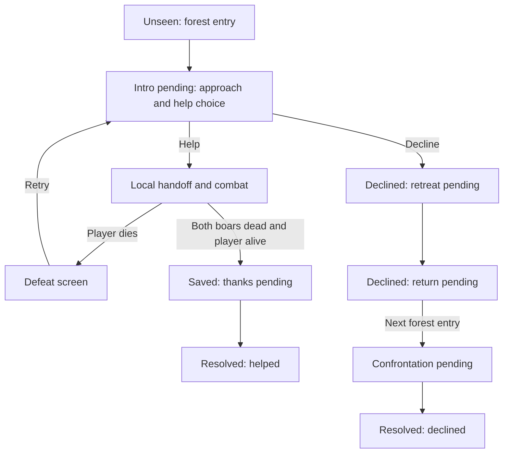

# Gatherer first encounter: forest rescue and simple combat

Date: 2026-10-14  
Status: Design proposal. This document does not implement gameplay. Numerical values, dialogue, and weapon choice below are recommended defaults.

## 1. Intended experience

The player's first entry into the forest introduces the Gatherer through a short playable encounter. The player automatically approaches a clearing where two boars are advancing on the Gatherer. The Gatherer notices the player and asks for help.

- **Help:** receive a melee weapon, fight both boars, then hear the Gatherer's thanks. Successfully helping creates a large favorable relationship change.
- **Decline:** automatically walk back toward the village. On the next forest entry, approach the Gatherer again, see both boars dead, and hear an angry response. The relationship begins with low trust and high aggression.
- **Die while helping:** restart at the beginning of the first cutscene with three full hearts and both boars alive. The player can choose again.

Success means this feels like the fisherman and craftsman introductions, with a small, readable combat interruption and a lasting social consequence. The encounter must finish cleanly on either branch and must not replay once resolved.

## 2. Existing project foundations

These observations come from the current working tree, including the existing, uncommitted craftsman work. File paths are relative to the repository root.

| Existing file | Relevant behavior | Use in this design |
| --- | --- | --- |
| `frontend/godot/scripts/main.gd` | Spawns Gatherer as NPC 2 at `(-650, 70)`; coordinates camera, UI, travel, and encounters | Add a small encounter integration point and suppress ordinary Gatherer interaction until resolution |
| `frontend/godot/scripts/fisherman_encounter.gd` | Automatic approach, scripted dialogue, input ownership, run-scoped introduction flag | Match the presentation; a single `intro_seen` flag is insufficient for the Gatherer's branches |
| `frontend/godot/scripts/craftsman_encounter.gd` | Routes the player to staging marks, owns input, handles persistence retries | Reuse these conventions |
| `frontend/godot/scripts/actor_router.gd` | Collision-aware routes, movement, arrival and blocked results | Reuse for entrance and retreat walks |
| `frontend/godot/scripts/player.gd` | `CharacterBody2D`, WASD movement at speed 180, control enable/disable | Retain movement and add a small separate combat controller |
| `frontend/godot/scripts/world_layout.gd` and `resources/island_layout.json` | Walkability and island geometry; forest recovery marker at `(-650, 70)` | Author encounter marks on valid ground near the existing Gatherer |
| `frontend/godot/project.godot` | Space is already assigned to cutscene fast-forward | Give combat a distinct action and prevent dialogue input from leaking into attacks |
| `backend/app/models/npc.py` | Trust, fear, aggression, curiosity fields | Apply explicit relationship outcomes to these existing values |
| `backend/app/models/player.py` | Run identity through `game_scope`, position, inventory, opening state | Scope encounter persistence and reset behavior to the current game |
| `backend/app/services/craftsman.py` | Durable encounter state, revisions, deduplicated commands | Follow its persistence pattern with a smaller Gatherer state machine |
| `backend/app/services/memory/service.py` | Stores memories with source IDs, scope, and provenance | Record the real outcome once for later dialogue |
| `frontend/godot/tests/forest_gatherer_smoke.gd` | Expects walking west and immediately opening Gatherer chat | Update this expectation to go through the new introduction |

The inspected player controller has no health or attack behavior. Treat combat as new work. Avoid adding the full encounter to the already broad `main.gd`.

## 3. Smallest useful combat approach

| Approach | Cost and trade-off |
| --- | --- |
| **Directional melee hitbox plus simple boar AI — recommended** | A short attack in front of the player, integer health, and visible attack timing. Delivers actual fighting with a small implementation |
| Press a prompted button during a scripted struggle | Less implementation, but little movement or combat agency; does not deliver the requested fight as well |
| General weapon, equipment, stamina, dodge, and enemy framework | Supports a larger action game, but creates unnecessary scope for two boars |

Use a **borrowed gathering knife** for the first version. It is a plausible melee tool and only needs a handoff line and a simple slash graphic. A short sword can replace it without changing the mechanics.

Recommended scope decisions:

- One melee attack, no combo, aiming mode, stamina, dodge, block, durability, loot, or experience system.
- Three hearts; one boar hit removes one heart. Each boar takes three successful hits.
- The Gatherer is protected during this encounter and has no health bar or combat AI. Player defeat is the only failure condition.
- The knife is encounter equipment, returned during the thanks scene. It is not added to transferable inventory. This avoids expanding item validation and equipment UI just for this fight.
- No combat outside the encounter in this first version. Keeping the weapon afterward can be a later feature.
- Ordinary NPC chat, inventory transfers, portals, and other encounter triggers are unavailable while this encounter is active. Pause and quit remain available.

## 4. Forest trigger and staging

### Entry detection

Author a forest-entry region at the village-to-forest transition, before the player reaches Gatherer interaction range. Use a region covering valid entrances rather than only a small proximity circle around the NPC. Crossing from outside to inside counts as entry.

Start only when the opening is complete, the world and encounter state are loaded, the player is outdoors, and no other dialogue, cinematic, travel, menu, or pending world mutation owns the player. If an overlay prevented the trigger, reevaluate when it closes while the player remains inside. On loading a save inside the forest with an unresolved introduction, stage it once after loading finishes.

Latch the active encounter immediately so overlapping trigger frames cannot start multiple copies. After declining, require an actual exit and later re-entry; remaining inside the region cannot trigger the second scene.

### Authored marks

Add a `gatherer_encounter.json` resource with these named marks and bounds:

| Mark | Purpose |
| --- | --- |
| `ForestEntryRegion` | Entry detection across traversable forest entrances |
| `IntroCheckpoint` | Safe forest-edge position from which the opening walk can restart |
| `PlayerTalkMark` | Player faces the Gatherer, with enough separation for the handoff |
| `GathererMark` | Existing clearing near `(-650, 70)`, with the Gatherer backed toward scenery |
| `BoarSpawnA/B` | Two boars visible between the forest and Gatherer |
| `BoarThreatA/B` | Endpoints of the short scripted advance, outside damage range |
| `CombatStartMark` | Clear position for the player when control returns |
| `CombatBounds` | A small, obstacle-light clearing with room to evade |
| `VillageReturnMark` | Clear ground outside the forest trigger, toward the village |

Coordinates other than the existing Gatherer location must be authored against the actual scenery and checked for foot clearance. Do not assume the recovery marker alone guarantees room for a fight. Adjust nearby props locally if needed.

Route automatic walking through `actor_router.gd`, using ordinary collision. Temporarily frame the player, Gatherer, and both boars with the existing camera, then restore normal follow behavior after resolution. Never tween the player through trees.

## 5. First-entry cutscene

1. **Capture checkpoint.** Save the encounter start and set its durable status to `intro_pending` before moving the player. Suppress normal interaction prompts.
2. **Automatic approach.** Disable manual movement and route the player toward `PlayerTalkMark`. The camera reveals the Gatherer and two boars. The Gatherer holds position, facing the threat.
3. **Show danger.** Move both boars a short distance toward `BoarThreatA/B`, then hold them. Use a snort and alert pose. Damage is disabled throughout staging and dialogue.
4. **Notice the player.** Turn the Gatherer toward the player and display the request.
5. **Explicit choice.** Present two buttons with no timer:
   - “I'll help. Give me something to fight with.”
   - “I can't help. I'm going back.”

Suggested dialogue:

> Gatherer: “You—over here! These two won't back off. Can you help me?”

The automatic presentation should take roughly 5–8 seconds excluding player-controlled dialogue. Continue/fast-forward can shorten dialogue and nonessential beats, but must stop at the choice. Closing a panel, pressing Escape, or skipping is never an implicit acceptance or refusal. Escape opens pause.

## 6. Help branch

### Handoff and tutorial

> Gatherer: “Take my knife. Keep your distance when they lower their heads.”

Show a brief reach/pass gesture or weapon icon moving toward the player. Equip the encounter knife, stage the player safely, show three hearts, and display:

> WASD to move • J to attack • Step aside when a boar prepares to strike

Use an Input Map action named `melee_attack`, initially bound to J. Enter/Space remain dialogue controls; UI events must be consumed. Keep the tutorial to one short Continue prompt; the boars remain harmless until it is dismissed. Wait for held dialogue buttons to be released before enabling combat.

Switch to `combat`, return movement and attack control, and give approximately one second of safe reaction time before the first boar begins an attack.

### Victory and thanks

When both boars have zero health and the player is alive:

1. Disable damage and attacks immediately. Leave both defeated boars visible.
2. Persist the successful outcome and relationship/memory changes once.
3. Route the player into conversation range if necessary; face both characters toward one another.
4. Play the thanks scene after the save succeeds.

> Gatherer: “They're down… Thank you. I don't think I could have kept them off much longer.”
>
> Gatherer: “You could have walked away. I'll remember that you stayed.”
>
> Player returns the borrowed knife.

Show a small “The Gatherer trusts you much more” notification. Mark the thanks presentation complete when its final beat is acknowledged, restore ordinary controls and camera, and unlock normal Gatherer chat. Hide encounter hearts and remove the borrowed weapon. Leave the corpses through the scene; remove them on the next forest exit for the minimum version.

## 7. Decline and return branch

### Leaving

> Gatherer: “You're leaving? They're right here!”

Persist refusal before beginning the retreat. Disable manual movement, hold the boars in their threat poses with damage off, and automatically walk the player to `VillageReturnMark`. End the cutscene only when the player has reached clear ground outside the entry region.

The refusal is a lasting choice after it is saved. No weapon is given. The Gatherer defeats the boars offscreen; no simulated fight is needed. Once the player has left, stage both boars as dead for the next visit.

### Next forest entry

Automatically walk the player to the Gatherer again. Show the two dead boars before the first dialogue line. The Gatherer faces the player with an angry pose.

> Gatherer: “Now you come back. I asked for help, and you left me with them.”
>
> Gatherer: “I dealt with it. Don't expect me to trust you.”

No fight occurs and the rescue choice is not offered again. Continue ends the confrontation and unlocks ordinary conversation with the negative relationship values already applied. Keep both corpses visible through the confrontation, then remove them on a later forest exit.

The Gatherer remains available for conversation and existing quests. High aggression means hostility in dialogue, not attacking the player. Trust can recover through later gameplay; refusal must not permanently break the ship-repair or bow progression.

## 8. Combat rules and starting values

All distances and times below are tuning defaults, not existing project constants.

| Rule | Starting value |
| --- | --- |
| Player health | 3 whole hearts |
| Player movement | Existing 180 world units/second |
| Player attack | One short rectangle/arc in the last facing direction |
| Reach / width | Approximately 44 / 36 world units; verify against actor art |
| Swing timing | 0.10 s windup, 0.12 s active, 0.23 s recovery |
| Attack damage | 1 health; a boar can be hit once per swing |
| Boar health | 3 each; six total hits if attacks hit one target at a time |
| Boar approach speed | Approximately 95 world units/second |
| Boar attack range | Approximately 30 world units |
| Boar attack timing | 0.60 s warning, one damage check, 0.90 s recovery |
| Damage to player | 1 heart per successful attack |
| Player damage immunity | 1.0 s shared across all incoming attacks |
| Knockback | Short collision-aware displacement, approximately 12–18 units |

### Player attack

Use one attack area in front of the player, active only during the strike window. Track a set of boars already hit by that swing. A held key must not emit attacks every physics frame; require a new press and respect recovery. A swing may hit both boars if both occupy its area. Face according to the last movement direction; start combat facing the threat.

Allow movement during swings for a forgiving first encounter. Give a brief slash graphic, hit flash, and small sound. Do not require a complete weapon animation set initially. NPCs and corpses are never valid damage targets.

### Boar behavior

Use a tiny finite-state machine: `approach → windup → strike → recover → approach`, with `dead` as a terminal state. Cinematic staging is a separate, harmless mode.

- Approach the player using collision-aware movement inside the clearing. Do not target the Gatherer during playable combat.
- Stop and face the player at windup start; show a lowered head and warning sound. Lock the attack direction for that strike so the player can move aside.
- At strike time, check a short frontal area once. No continuous contact damage and no high-speed charge are needed.
- Only one boar may wind up or strike at a time. A shared attack token allows the other boar to approach and wait. Release the token on recovery, interruption, or death; impose a short gap before the next windup.
- Player hits interrupt windup and briefly stagger a living boar. They cannot deal repeated damage from a persistent overlap.
- Clamp knockback with world collision. Keep player and boars inside an encounter-only boundary during combat; give “Help the Gatherer defeat both boars” feedback at the exit. Pause still works.
- In the obstacle-light clearing, direct steering should suffice. If a boar stalls, use the existing router to a nearby clear approach point. Do not leave an unreachable enemy preventing victory.

Resolve damage events in a consistent physics-step order. If the player reaches zero hearts in the same step as the last boar dies, defeat takes precedence; never send both victory and retry outcomes.

## 9. Three hearts, defeat, and checkpoint

At zero hearts, stop every actor and damage source, show a short fall/fade, and offer **Retry encounter** or **Quit to menu**. Retry returns to the beginning of the first cutscene, including automatic walking and the help/decline choice.

Checkpoint contents are deliberately small:

- Run scope and encounter attempt ID.
- A valid `IntroCheckpoint` position and facing.
- Unresolved encounter status and initial staging resource/version.

Retry reconstructs the encounter instead of trying to reverse arbitrary world state:

- Three full hearts; two living boars at full health and their spawn marks.
- Gatherer at the original threat mark and pose.
- No borrowed weapon until the player accepts again.
- Cleared attack timers, damage immunity, hit sets, routes, UI panels, and camera overrides.
- No gratitude memory, relationship reward, refusal penalty, or permanent inventory change from the failed attempt.
- Existing inventory, quests, and pre-encounter relationships remain intact.

Do not call the current whole-game restart flow. Death is a local retry, not a new run. No permanent social changes occur merely for agreeing, taking damage, or dying, so no relationship rollback is required.

On quit/reload during the opening, handoff, combat, or defeat screen, resume at this same encounter start. Saving every swing, health value, and AI timer is unnecessary. Explain this with “Resume from the start of the encounter” in the quit flow when applicable.

## 10. Relationship outcomes and memory

The current Gatherer baseline is trust 0.50, fear 0.25, aggression 0.05, and curiosity 0.70. Use the existing normalized 0–1 fields; a separate friendship stat is unnecessary.

| Outcome | One-time proposed update | Result from the current baseline |
| --- | --- | --- |
| Saved by player | Trust +0.35, fear −0.15, aggression −0.05, curiosity +0.10; clamp each to 0–1 | Trust 0.85, fear 0.10, aggression 0.00, curiosity 0.80 |
| Refused help | Trust becomes `min(current, 0.15)`; aggression becomes `max(current, 0.75)`; leave fear and curiosity unchanged | Trust 0.15, aggression 0.75 |

Apply success when victory is durably committed. Apply refusal when the player explicitly declines, before the retreat; the later confrontation presents that consequence and does not apply it again. This prevents quitting before the return visit from erasing the choice.

Store exactly one authoritative, run-scoped outcome memory with a stable source event ID:

- Success: “The player accepted my request, took my borrowed knife, and helped defeat the two boars threatening me.” Emotional framing: gratitude and relief.
- Refusal: “I asked the player for help against two boars. They refused and returned toward the village; I dealt with the boars myself.” Emotional framing: anger and distrust.

Use provenance values supported by the existing memory pipeline for an observed system event. Update memory revision/cache state through the existing mechanism. Include the encounter outcome in ordinary conversation context explicitly, so remembering this first meeting does not depend solely on semantic retrieval.

Script these encounter lines and state changes. The LLM can phrase later conversations using the recorded facts, but cannot award trust, resurrect boars, invent a successful rescue, or change the chosen branch. Route the encounter before ordinary chat so the player cannot bypass it by pressing E or claiming to have killed the boars.

## 11. Encounter state and persistence

Keep durable story state separate from temporary presentation and combat state.

Suggested durable fields: `game_scope`, `revision`, `status`, `checkpoint`, `attempt_id`, and recorded command results. Status carries the branch; avoid independent booleans that can describe conflicting outcomes. Local phases include approach, threat, choice, handoff, combat, defeat, thanks, retreat, and confrontation.

| Durable status on load | Recovery behavior |
| --- | --- |
| `unseen` | Wait for an eligible forest entry, or stage once if already inside |
| `intro_pending` | Restore checkpoint and replay initial cutscene; combat is reconstructed |
| `saved_thanks_pending` | Both boars remain dead; resume thanks without replaying combat or rewards |
| `declined_retreat_pending` | Resume automatic retreat; never offer the rescue choice again |
| `declined_return_pending` | Wait for next entry; if loaded inside forest, stage confrontation once |
| `declined_confrontation_pending` | Restore the two corpses and resume confrontation |
| `resolved_helped` / `resolved_declined` | Normal exploration and conversation; no automatic encounter |

Use a dedicated backend encounter record scoped to the player and current `game_scope`, following the craftsman pattern. Include it in the world snapshot and reset it for a genuinely new game. Reuse schema initialization/migration conventions and reset the associated outcome memories with the existing new-game lifecycle.

Minimum command contract: begin introduction, begin accepted attempt, restart attempt, commit victory, decline, complete retreat, begin confrontation, and finish the appropriate presentation. Each command validates its allowed source state and expected revision. Victory requires the currently accepted attempt, not merely an arbitrary chat message. Advancing an attempt ID on retry invalidates stale victory callbacks.

Godot owns moment-to-moment combat for this single-player MVP. Backend checks enforce story transitions and deduplication; they do not independently simulate or prove every hit. Do not build a server combat loop for this encounter.

Commit branch status, emotions, outcome memory, and command result in one transaction. Use stable request IDs so retrying after a lost response cannot repeat a reward or penalty. Do not retry a victory with a new ID because the first response timed out. On a revision conflict, fetch current state and reconcile before issuing further commands.

For legacy saves with no Gatherer encounter record, default to `unseen` even if the player previously chatted with the Gatherer. Preserve their current relationships and use the formulas above. This deliberately makes the new scene available on existing saves without deleting prior progress.

## 12. Integration responsibilities

Proposed new files, not files already implemented:

| File or area | Responsibility |
| --- | --- |
| `frontend/godot/scripts/gatherer_encounter.gd` | Trigger, staging, phases, choice, checkpoint reconstruction, camera/input ownership, branch presentation |
| `frontend/godot/scripts/gatherer_gateway.gd` | Encounter commands, scope, revisions, retries, world-state reconciliation; follow craftsman gateway conventions |
| `frontend/godot/scripts/player_combat.gd` | Hearts, facing-aware melee attack, cooldown, immunity, defeat signal |
| `frontend/godot/scripts/boar.gd` | Boar movement, attack states, health, dead pose, damage signals |
| `frontend/godot/resources/gatherer_encounter.json` | Staging marks, trigger and arena bounds, tuning |
| `frontend/godot/resources/gatherer_dialogue.json` | Authored first meeting, handoff, thanks, refusal, confrontation lines |
| `backend/app/models/gatherer_encounter.py` | Durable run-scoped encounter record |
| `backend/app/services/gatherer.py` | Validated transitions, checkpoint policy, atomic outcome application |
| `backend/app/schemas/gatherer.py` and `api/routes/gatherer.py` | Typed commands/snapshots and API integration |
| Existing context/memory pipeline | Persistent outcome facts and later relationship-aware dialogue |

Keep hearts and encounter dialogue UI local to the encounter initially; extract a general HUD only when another feature needs it. The combat controller emits damage/defeat signals; boars emit death signals; the encounter decides victory. The gateway handles durable changes. `main.gd` only wires these together and arbitrates with existing systems.

Input ownership must distinguish cinematic mode from combat mode: both reserve the encounter and block other interactions, but combat explicitly permits player movement and attacks. Using a single “UI owns input” boolean to disable everything would accidentally freeze the fight. Pause freezes boar timers, damage, player attacks, and automatic routes together.

## 13. Recovery and edge cases

- **Blocked automatic walk:** stop actors safely, retry a route once, then show a clear Retry/quit recovery panel. Keep the durable branch intact. Never teleport through scenery during a visible cutscene. A checkpoint restore may reposition during a fade.
- **Failed save before staging or refusal:** hold a harmless scene with Retry; do not enable combat or finish leaving until the required state is saved. A deliberate Retry reuses the same request ID.
- **Failed victory save:** keep dead boars and freeze damage while offering Retry. Do not show final completion or unlock normal chat until the outcome is confirmed.
- **Quitting during a pending save:** settle it when possible; otherwise load authoritative backend status next time. A committed victory resumes thanks, while an uncommitted attempt restarts the introduction. No assumed local reward survives on its own.
- **Reload during retreat:** complete the retreat before arming return detection, even if the player was saved inside the forest.
- **Repeated entry or Continue events:** latch transitions and disable choice buttons while a command is pending. Completion callbacks and corpse cleanup are safe to repeat.
- **Other NPC interactions:** suppress chat, transfer, and quest requests for the active encounter; preserve unrelated quest state. Restore normal interaction afterward.
- **New game during encounter:** invalidate pending callbacks using scope and attempt checks, free combat actors, and clear all input/camera ownership.
- **Pause or focus loss:** no hidden damage or route advancement while the game is paused. Resume without an immediate queued attack.
- **Corpse collisions:** dead boars have no attack or movement collision that could block the approach, retreat, or thanks route.

## 14. Suggested implementation order

1. Author entry region, staging marks, and clear combat space. Confirm walk routes with the existing router.
2. Build the encounter state record, commands, snapshot integration, and recoverable state transitions.
3. Build the first cutscene, choice, refusal retreat, and return confrontation using placeholder boars. Verify input restoration and persistence before adding fighting.
4. Add hearts, directional melee, two boar controllers, shared attack timing, and defeat/retry reconstruction.
5. Connect victory, thanks, relationship updates, authoritative memory, and later dialogue grounding.
6. Add final boar poses, knife slash/handoff, audio, camera timing, UI polish, and checks below.

This sequence gives an early playable version of both branches without building an unrelated combat framework. No new game engine plugin or external service is required by the proposal.

## 15. Acceptance and validation checklist

### Player-visible behavior

- First eligible forest entry starts exactly one scene and automatically walks the player to the Gatherer.
- Two live boars visibly advance before the Gatherer asks for help; neither can deal damage during dialogue.
- Accepting visibly hands over a melee weapon, shows three hearts, and gives movement/attack control.
- Each attack damages each boar at most once; two overlapping boars cannot remove multiple hearts inside the shared immunity window.
- Both boars can be defeated without taking unavoidable damage; warning, reach, and recovery feel readable in a rendered playtest.
- Killing both while alive begins thanks and causes a large favorable relationship change once.
- Losing all hearts restarts the opening cutscene, restores both boars and three hearts, and permits a different choice.
- Declining automatically returns the player toward the village. Coming back starts the angry scene with two dead boars.
- Normal Gatherer dialogue after refusal reflects low trust and high aggression without preventing ongoing quest play.
- Neither resolved branch automatically replays on further forest entries.

### Automated checks worth adding during implementation

- Backend state-transition tests reject victory before acceptance, stale attempts, cross-scope commands, and impossible branch changes.
- Retried outcome commands create exactly one emotion update and one memory; reload reflects the committed branch.
- Frontend combat checks cover three-hit deaths, per-swing deduplication, shared immunity, attack-token release on death, and simultaneous final hits.
- Save/reload checks exercise every durable state, especially combat, pending thanks, retreat, and confrontation.
- Headless encounter checks verify trigger latching, both choice paths, retry restoration, input ownership, and paused timers.
- Update the existing forest smoke test to resolve an encounter before asserting ordinary chat. Keep fisherman, opening, craftsman, inventory, and quest regression checks.

### Rendered checks

Walk into the forest from every valid approach. Check automatic paths against actual tree collisions, boar visibility, arena escape feedback, camera framing, hitboxes against the art, and readability at the project's 960×540 minimum and 1280×720 default window sizes. Play through help, death then retry, and decline then return. Headless tests alone cannot establish that attacks feel fair.

## 16. Deferred additions

Persistent weapons, equipment menus, multiple attack types, dodge rolls, shields, additional enemies, enemy loot, Gatherer companion combat, world-wide player health, and a general checkpoint/save-slot system are outside this first version. The proposed encounter supplies the requested choice, playable fight, relationship consequences, and reliable restart with only the mechanics it needs.
